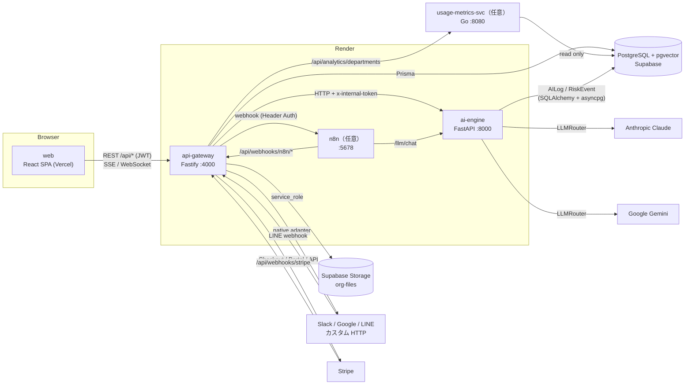
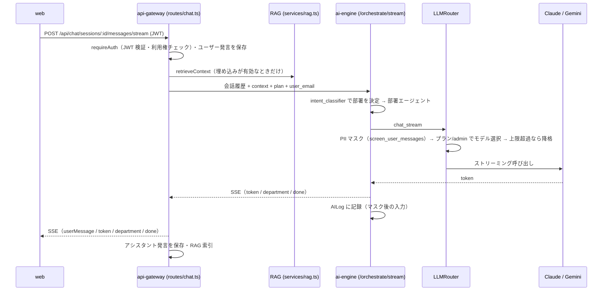
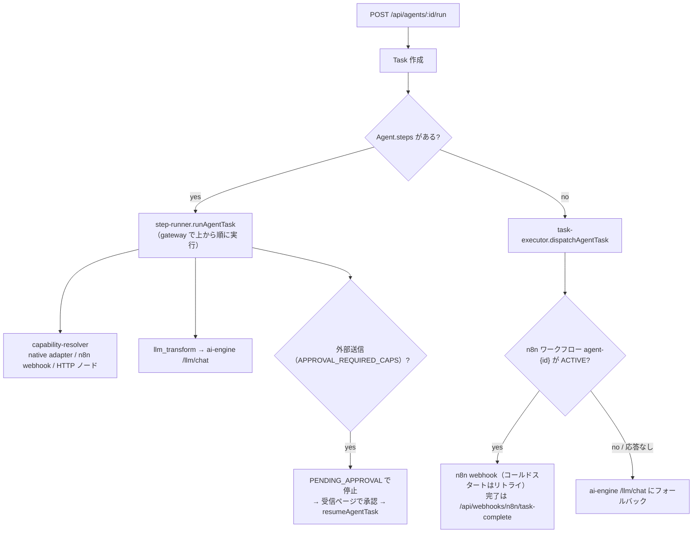

# アーキテクチャ

FLOW（org-ai-platform）の構成と、リクエスト・データがどう流れるかをまとめる。
2026-11 時点のコードを読んで書いている。機能ごとの設計判断（経理・決済・ファイル保存など）は
[CLAUDE.md](../CLAUDE.md) を正とし、ここでは「どこで何が起きるか」に絞る。

## 1. コンポーネント

| コンポーネント | 責務 | 持たないもの |
|---|---|---|
| web | 画面・状態管理（zustand / TanStack Query）・API 呼び出し（`src/services/api.ts`） | LLM の直接呼び出し、シークレット |
| api-gateway | 認証（JWT）・権限・利用権（解約後の読み取り専用）・全 API・DB の読み書き・ファイル保存・外部連携・エージェントのステップ実行・定期実行・Stripe | LLM プロバイダの直接呼び出し（必ず ai-engine 経由） |
| ai-engine | Intent 分類・部署エージェント・プランナー・LLMRouter（松竹梅・上限超過時の降格）・PII 検知・AILog 記録・領収書読み取り | ユーザー認証（gateway からの共有シークレットのみ見る） |
| n8n | 部署/capability/エージェント専用ワークフローの実行（加速レイヤー）。LLM が要るノードは ai-engine `/llm/chat` を呼び、結果は gateway の `/api/webhooks/n8n/*` に返す | 正本のデータ。落ちていても gateway が ai-engine で完了させる |
| usage-metrics-svc | AILog を SQL で集計して部署別 KPI を返す | 書き込み（読み取り専用） |

## 2. 主要なデータフロー

### 2.1 チャット（web → gateway → ai-engine → LLMRouter）

- 非ストリーミング版は `POST /api/chat/sessions/:id/messages` → ai-engine `/orchestrate`。
- その他の LLM 呼び出し（営業提案・SNS 投稿・受信箱の返信下書き・ステップの `llm_transform` 等）は
  gateway から ai-engine `/llm/chat` を叩く。プランナー系は `/plan`・`/plan/agent`・`/plan/http-node`・`/rank`。
- ai-engine は `INTERNAL_API_TOKEN` が設定されていれば `x-internal-token` を検証する（`/health` 等を除く）。

### 2.2 エージェント実行（n8n / step-runner）

`POST /api/agents/:id/run`（`routes/agents.ts`）が `Task` を作り、エージェントの形で分岐する。

- ステップ実行の状態は `Task.executionResult` に JSON で毎ステップ保存する（再開・回収のため）。
- 起動直後に `recoverStaleRunningTasks` が、デプロイで取り残された RUNNING を FAILED にする。
- SIGTERM では `services/lifecycle.ts` が実行中の処理を `SHUTDOWN_DRAIN_MS` まで待つ。

### 2.3 定期実行

- 発火は `services/schedule-dispatcher.ts` に集約。`ScheduledTask.lastRunAt` の条件付き `updateMany`
  （atomic claim）で二重発火を防ぐ。
- 起動元は 2 つあり、併走しても安全: gateway 内 tick（`startInternalScheduler`、5 分間隔、
  `INTERNAL_SCHEDULER_ENABLED=false` で無効）と、n8n の `schedule-dispatcher` ワークフロー
  （`/api/webhooks/n8n/scheduled-jobs` → `/enqueue-scheduled-task`）。
- `ScheduledTask.agentId` があればエージェント実行（steps があれば step-runner）。

### 2.4 Webhook（受け口）

| パス | 送り手 | 処理 |
|---|---|---|
| `/api/webhooks/n8n/*` | n8n | タスク完了・ログ・キュー取得・定期実行（Header Auth のトークンで検証）。業務ページの登録 `/api/webhooks/n8n/pages/*` だけは組織ごとの登録トークン（`x-page-token`） |
| `/api/webhooks/line/*` | LINE | 受信箱に積む。画像は `/vision/receipt` で読み取り、原価の **DRAFT** を作る（画像は保存しない） |
| `/api/webhooks/stripe` | Stripe | 署名検証 → サブスクリプションを取り直して組織に写す（`services/billing/sync.ts`） |

### 2.5 決済（Stripe）

- 新規契約は Checkout、支払い方法・請求書・解約はカスタマーポータル（`routes/billing.ts`）。
  プラン変更と追加容量はアプリ内。SDK は使わず `services/billing/stripe-client.ts` が REST を叩く。
- 組織への反映は webhook が正本（`services/billing/webhook-handler.ts` → `sync.ts`）。
- 解約後は書き込み（POST/PUT/PATCH/DELETE）を 402 で止める。判定は `services/entitlement.ts`、
  適用は `middleware/auth.ts` の `requireAuth`。決済・認証・webhook の経路は止めない。

### 2.6 ファイル保存（Storage）

- `services/storage/` が保存先を抽象化（`local-driver.ts` / `supabase-driver.ts`）。
  新規は Supabase（設定があれば）、行ごとに `UploadedFile.storageDriver` を記録して読むときはその driver を使う。
- 容量判定は shared-types の `canUpload()` だけ。使用量は `Organization.storageUsedBytes` を
  保存/削除と同じトランザクションで増減する。
- service_role キーは RLS を貫通するので、組織の切り分けはアプリ側（キー先頭の orgId と `keyBelongsToOrg`）。
- アップロードされた文書は抽出 → 分割 → 埋め込みして `FileChunk`（pgvector）に索引する（RAG）。

### 2.7 業務ページ（n8n 連携）

- 組織ごとの画面 `/p/:slug`。定義（許可リストのブロックとアクション）は DB の `CustomPage` が正本で、
  n8n が組織ごとの登録トークンで `PUT /api/webhooks/n8n/pages/:slug` する（`routes/n8n-pages.ts` → `services/pages/upsert.ts`）。
- データ取得（GET `/api/pages/:slug/data/:actionId`）と送信（POST `/api/pages/:slug/actions/:actionId`）は
  `services/pages/action-runner.ts` が `pages/<orgId>/<hook>` の n8n Webhook に届ける。ai-engine へのフォールバックはしない（未接続を出す）。
- 応答は shared-types の `projectQueryResult` で定義どおりに切り詰めてから web に返す。送信は `PageActionLog` に記録し、月間の上限（`PAGE_LIMITS`）を数える。
- 開発は seed（`packages/db-schema/prisma/seed-pages.ts`）＋ `PAGES_SAMPLE_MODE=true` で n8n 無しに動く。
  設計は `docs/design/custom-pages.md`、構築手順は `docs/custom-pages-n8n.md`。

## 3. 主要ディレクトリと責務

### apps/api-gateway/src

| パス | 責務 |
|---|---|
| `index.ts` | Fastify の組み立て（CORS・JWT・multipart・websocket）、ルート登録、`/health` `/ready`、起動時処理 |
| `config/env.ts` | 環境変数の唯一の読み口（`envSchema` / `ENV_DEFAULTS` / `config`） |
| `middleware/auth.ts` | `requireAuth`（JWT + 利用権）・`requireRole` / `requireAdmin` / `requireOwner` |
| `routes/` | HTTP ルート（`/api/<領域>`）。部署ごとのサブディレクトリ: `accounting/` `sales/` `sns/` `analytics/` `inbox/` |
| `services/` | ドメインロジック: step-runner / task-executor / capability-resolver / schedule-dispatcher / rag / embeddings / adapters（Slack・Google）/ http-node（カスタム HTTP ノードの SSRF ガード含む）/ inbox（LINE）/ billing / storage / lifecycle |
| `utils/` | `http-error.ts`（`sendError`）・`logger.ts`・`prisma.ts`（PrismaClient の単一インスタンス）・`fileExtractor.ts` |

### apps/ai-engine/app

| パス | 責務 |
|---|---|
| `main.py` | FastAPI のエンドポイント・内部トークンの middleware |
| `config.py` | 環境変数の唯一の読み口（`settings`） |
| `orchestrator/` | Intent 分類と部署エージェントへの振り分け（`/orchestrate`） |
| `agents/` | 部署エージェント（sales / marketing / accounting / analytics / general） |
| `planner/` | capability / エージェント / HTTP ノードの計画、領収書読み取り |
| `llm/router.py` + `llm/providers/` | LLMRouter（モデル選択・PII マスク・降格）と Anthropic / Gemini のプロバイダ |
| `governance/` | PII 検知（`pii_screener.py`）・AILog 記録（`audit_logger.py`）・月間利用量（`usage.py`） |
| `db.py` | Prisma 形式の `DATABASE_URL` を SQLAlchemy(async) に変換 |

### apps/web/src

| パス | 責務 |
|---|---|
| `pages/` | ルート単位の画面 |
| `components/` | 部署・機能別のコンポーネント、`ui/` `shell/` `motion/` は共通部品 |
| `store/` | zustand のストア（auth / chat / 部署フィルタ / 成果物） |
| `services/api.ts` | axios インスタンス（`VITE_API_URL`、JWT 付与） |
| `taskmanager/` | タスク管理画面（IndexedDB = dexie を使うローカル完結の機能） |

### packages

- `shared-types`: web と gateway で共有する型・定数（プラン上限、`canUpload()`、承認が要る capability など）。
- `db-schema`: Prisma スキーマ・マイグレーション・seed（デモ組織と業務ページのサンプル）。ai-engine と usage-metrics-svc は同じテーブルを SQL で読む。

## 4. 設定（環境変数）の読み込み口

| サービス | 読み口 | 方針 |
|---|---|---|
| api-gateway | `apps/api-gateway/src/config/env.ts` | `envSchema`（zod）で一覧化、既定値は `ENV_DEFAULTS` だけに書く。`config.*` は getter で毎回 `process.env` を読む（テストが env を差し替えるため） |
| ai-engine | `apps/ai-engine/app/config.py` | `settings.*` プロパティが毎回 `os.environ` を読む。`main.py` が最初に `load_dotenv()` |
| web | `import.meta.env.VITE_*` | ビルド時に埋め込み。`VITE_API_URL` / `VITE_WS_URL` / `VITE_METRICS_URL`（dev は `VITE_PROXY_TARGET`） |

一覧と既定値は [.env.example](../.env.example)。ここに無い場所で `process.env` / `os.environ` を読まないこと。

## 5. エラーフォーマット

- gateway の API エラーは `{ success: false, error: { code, message } }`。
  `utils/http-error.ts` の `sendError(reply, status, code, message)` で返す。
  上流（ai-engine 等）のステータスは `upstreamStatus()` で写す（5xx は 502 にまとめる）。
- 成功は `{ success: true, data }` が基本形。
- ai-engine は FastAPI 標準（`{ "detail": ... }`）。gateway が受けて上の形に包み直す。
- シークレット・内部例外の文言・Stripe のエラー文言は利用者に返さない。

## 6. ログ方針

- gateway は `utils/logger.ts` の `createLogger(scope)` を使う（出力は `[scope] message`、console に出て Render のログに流れる）。
  `console.*` を直接書かない。エラーは `errorMessage(e)` でメッセージだけを載せる。
- ai-engine は `logging.getLogger(__name__)`（`print` は使わない）。
- **AI の入出力は AILog テーブルに記録する**（ai-engine の `audit_logger.schedule_llm_log`）。入力はマスク後を残す。
  PII 検知時は `RiskEvent` も作る。月間上限の判定も AILog の件数で数える。
- 秘密の値（API キー・トークン・資格情報）はログにもレスポンスにも出さない。

## 7. テスト方針

| 対象 | 置き場所 | 方式 |
|---|---|---|
| api-gateway（単体） | `src/**/__tests__/*.test.ts` | vitest。prisma・fetch を `vi.mock` / `vi.spyOn` でモック |
| api-gateway（ルート） | `tests/<領域>/*.test.ts` | Fastify の `app.inject()` で HTTP の形を検証。DB はモック |
| api-gateway（統合） | `tests/integration/*.int.test.ts` | `npm run test:int`。実 Postgres + pgvector（`TEST_DATABASE_URL`）でマイグレーション・DoD の通し・raw SQL の組織分離。Stripe は偽物 |
| web | `src/**/__tests__/*.test.ts` | vitest（純粋関数中心） |
| shared-types | `src/__tests__/` | vitest |
| ai-engine | `apps/ai-engine/tests/` | pytest。`test_main_api.py` は TestClient で HTTP API の形を固定する特性テスト。LLM はスタブ |
| 契約 | `tests/fixtures/` | gateway と ai-engine が同じフィクスチャを読む（プラン→モデル、資格情報サンプル） |
| usage-metrics-svc | `usage-metrics-svc/internal/**` | `go test` |

- 統合テスト以外は DB・外部 API・シークレットなしで通る（CI もそれで回す）。統合テストは CI の integration ジョブが使い捨ての pgvector サービスで回す。
- テストコードも型チェックする（api-gateway / shared-types は `tsconfig.test.json`）。
- 実行コマンドは [README](../README.md#テストlint型チェック) を参照。
