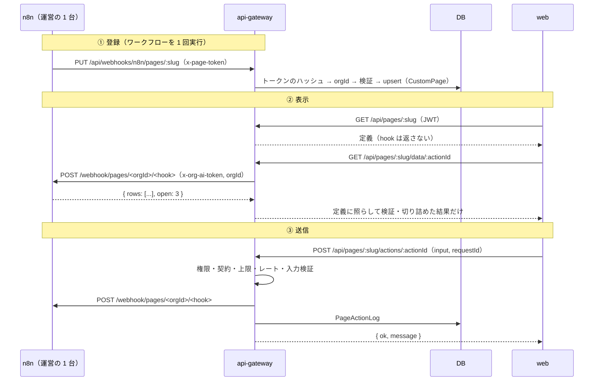

# 業務ページ（n8n 連携）設計

> **一行要約**: 組織ごとの「ページ定義（JSON）」を DB に持ち、n8n が登録トークンで upsert する。web は許可リストのブロックだけを描画し、データ取得・フォーム送信・ボタンは必ず gateway を通って、その組織専用の n8n Webhook（`pages/<orgId>/<hook>`）にだけ届く。

- 状態: 設計（未実装）。2026-11-18。ブランチ `feat/custom-pages`
- 前提にした既存の決まり: CLAUDE.md、DESIGN.md、`docs/ARCHITECTURE.md`、`docs/design/multi-tenancy.md`、`docs/n8n-integration-design.md`、`docs/plan/saas-readiness-plan.md` §2・§7
- 既存の原則は変えない: **DB が真実の源 / n8n は加速レイヤー / ルートは `authOf(request).db` だけ / エラーは `{ success:false, error:{ code, message } }` / LLM は必ず ai-engine の LLMRouter 経由**

---

## 0. 既存の n8n 連携（確認した事実）

| 向き | 何をしているか | 認証 | 実装 |
|---|---|---|---|
| gateway → n8n | 部署 `dept-*`・capability `cap-*`・エージェント `agent-<id>` の Webhook を `POST ${n8nUrl}/webhook/<path>` で叩く。到達不可なら ai-engine にフォールバック | ヘッダ `x-org-ai-token: N8N_WEBHOOK_AUTH_TOKEN`（n8n 側は Header Auth credential `org-ai webhook token`） | `services/task-executor.ts` `capability-executor.ts` `capability-resolver.ts` |
| n8n → gateway | `/api/webhooks/n8n/{task-complete,task-log,queued-tasks,scheduled-jobs,enqueue-scheduled-task,scheduled-job-complete}` | ヘッダ `x-webhook-token`（同じ共有トークン）＋ body の `orgId` を行の orgId と照合（`N8N_CALLBACK_ORG_REQUIRED`） | `routes/webhooks.ts` |
| n8n → ai-engine | LLM が要るノードは `/llm/chat`（AILog・PII・上限は LLMRouter 側で効く） | `x-internal-token` | ワークフロー JSON |
| 設定 | n8n は **運営が持つ 1 台**（`N8N_CLOUD_URL` → `N8N_URL` → 既定 localhost）。本番で共有トークンが既定値なら起動拒否 | — | `config/env.ts` `config/startup-checks.ts` |
| 置き場所 | `apps/n8n-workflows/*.json`、取り込みは `npm run n8n:import` | — | `scripts/n8n-import-workflows.mjs` |

ここから導かれる前提: **n8n は全テナント共有の 1 台で、ワークフローを作るのは運営（または運営が任せた構築担当）**。顧客は n8n に入らない。「お客さんごとのページ」は、運営が n8n でその顧客向けのワークフローを作ることで生まれる。

---

## 1. 用語・ゴール・非ゴール・完了条件

### 1.1 用語

| 用語 | 意味 |
|---|---|
| 業務ページ | 組織ごとに持てる画面。`/p/:slug`。既存の固定の業務ページ（営業・分析・SNS・経理）とは別物で、サイドバーの同じ見出し「業務ページ」の下に並ぶ |
| ページ定義 | 1 ページの JSON（`blocks` と `actions`）。DB の `CustomPage.definition` |
| ブロック | 画面の部品。許可リストの 7 種だけ |
| アクション | ページ定義の中の名前付きの n8n 呼び出し。`query`（データ取得）と `submit`（フォーム送信・ボタン）の 2 種 |
| hook | アクションが指す n8n Webhook の末尾の名前。URL は gateway が `pages/<orgId>/<hook>` に組み立てる |
| ページ登録トークン | n8n がページを登録するための、組織ごとの秘密。DB にはハッシュだけ |
| サンプルモード | n8n 無しで画面を確かめる開発用の動作。seed が入れた `sampleData` を返す |

### 1.2 ゴール

| # | ゴール |
|---|---|
| G1 | 組織ごとに専用のページを持てる（他の組織からは存在も見えない） |
| G2 | n8n のワークフローを 1 回実行すると、その組織の FLOW にページが現れる（コードのデプロイ不要） |
| G3 | ページ上のデータ表示・フォーム送信・ボタンが、gateway 経由で n8n ワークフローとして動く |
| G4 | n8n が無い・落ちているときもページは開き、データ部だけ「未接続」になる |
| G5 | プランで差が付く（ページ数・月間実行数）＝カスタマイズが上位プランの理由になる |

### 1.3 非ゴール（v1 でやらない）

| 非ゴール | 理由 |
|---|---|
| 任意の HTML / JS / CSS / iframe / 外部 URL の埋め込み | XSS と見た目の崩れ。ブロックの許可リストで足りる範囲に留める |
| 画面上のビジュアルエディタ・JSON 編集 UI | 構築は n8n 側。設定画面は公開・並び・削除・トークンだけ |
| 顧客が自分の n8n を繋ぐ（組織ごとの n8n URL） | 任意 URL への送信＝SSRF の面が増える。必要になったら `http-node/url-guard.ts` を通す形で別設計 |
| ファイル添付・画像・グラフのブロック | 保存容量・電帳法・描画ライブラリの判断が要る。後続 |
| ページ定義の履歴・差し戻し | 正本は n8n のワークフロー。`version` と監査記録だけ持つ |
| リアルタイム更新（WebSocket / ポーリング） | 手動の更新ボタンと送信後の再取得で足りる |
| 既存の固定ページ（営業・経理など）の置き換え | 既存の設計軸を変えない |

### 1.4 完了条件（DoD）

| # | 条件 | 確かめ方 |
|---|---|---|
| D1 | デモ組織でサンプルページ「問い合わせ」が、n8n 無しで KPI・表・フォーム・ボタンまで表示される | seed → `PAGES_SAMPLE_MODE=true` → `/p/inquiries` |
| D2 | サンプルの n8n ワークフローを入れて「登録」を 1 回実行すると、設定 > 業務ページ に下書きで現れ、公開するとメンバーのナビに出る | 手動（§12 ユーザー作業の後） |
| D3 | フォーム送信が n8n に届き、表が更新される。定義に無い項目・型違いは 400 で n8n に届かない | gateway テスト |
| D4 | 組織 A のトークンで組織 B のページを読めない・登録できない・アクションを叩けない。A のアクションが B の Webhook パスに届くことは構造的に無い | 分離テスト |
| D5 | ページ数の上限・月間実行数の上限がプランどおりに効き、帯と設定画面に出る | shared-types / gateway テスト |
| D6 | 390px で 1 列・横スクロール無し・押せる要素 44px 以上 | web テスト＋目視 |
| D7 | `npm run lint` / `typecheck` / `test` / `build` / `test:int` が通る | CI |

---

## 2. 全体像



---

## 3. データモデル

マイグレーション 1 本: `packages/db-schema/prisma/migrations/2026112x000000_add_custom_pages`（手書き SQL の流儀。追加のみ・既存行に影響なし）。

### 3.1 `CustomPage`（ページ定義）

| 列 | 型 | 内容 |
|---|---|---|
| `id` | String cuid | |
| `orgId` | String | `Organization` への FK（onDelete: Cascade） |
| `slug` | String | `^[a-z0-9](?:[a-z0-9-]{0,38}[a-z0-9])?$`。`@@unique([orgId, slug])` |
| `title` | String | 1〜24 文字。ナビとページ見出し |
| `icon` | String | 許可リスト（§4.2）。既定 `file-text` |
| `sortOrder` | Int | 並び順（小さい順、同値は `createdAt`）。既定 0 |
| `status` | String | `'DRAFT' \| 'PUBLISHED'`（DB enum にしない＝既存の流儀）。既定 `DRAFT` |
| `minRole` | String | `'MEMBER' \| 'ADMIN' \| 'OWNER'`。これ未満の人には一覧にも出さない。既定 `MEMBER` |
| `source` | String | `'N8N' \| 'MANUAL' \| 'SEED'`（作成元） |
| `version` | Int | 定義が変わるたびに +1。既定 1 |
| `schemaVersion` | Int | ブロックスキーマの版。v1 は 1 |
| `definition` | Json | `{ blocks, actions }`（§4）。保存前に必ず zod を通す |
| `definitionHash` | String | 正規化した定義の sha256。同じ内容の再登録を無変更にする（冪等） |
| `sampleData` | Json? | サンプルモード用の応答（アクション ID → 応答）。**seed だけが書ける**。API からは書けない |
| `createdBy` / `updatedBy` | String? | User.id。n8n 経由は null |
| `createdAt` / `updatedAt` | DateTime | |

索引: `@@unique([orgId, slug])`、`@@index([orgId, status, sortOrder])`。

### 3.2 `PageToken`（ページ登録トークン）

| 列 | 型 | 内容 |
|---|---|---|
| `id` | String cuid | |
| `orgId` | String | FK（Cascade） |
| `label` | String | 1〜24 文字（「n8n 本番」など） |
| `tokenHash` | String `@unique` | sha256(生トークン)。**生値は保存しない**（`Invitation.tokenHash` と同じ流儀） |
| `prefix` | String | 生トークンの先頭 10 文字（`flowpg_abc`）。一覧での見分け用 |
| `lastUsedAt` | DateTime? | 使われるたびに更新（1 分に 1 回まで） |
| `revokedAt` | DateTime? | 失効 |
| `createdBy` | String | |
| `createdAt` | DateTime | |

索引: `@@index([orgId, createdAt])`。

### 3.3 `PageActionLog`（送信の記録＝監査と月間実行数の正本）

| 列 | 型 | 内容 |
|---|---|---|
| `id` | String cuid | |
| `orgId` | String | FK（Cascade） |
| `pageId` / `slug` / `actionId` | String | 何を押したか（ページを消しても読めるよう slug も持つ） |
| `pageVersion` | Int | 押した時点の定義の版 |
| `actorId` | String | 押した人 |
| `requestId` | String | web が送信ごとに作る UUID。`@@unique([orgId, requestId])` で二重送信を止める |
| `status` | String | `'OK' \| 'FAILED' \| 'TIMEOUT' \| 'INVALID_RESPONSE'` |
| `durationMs` | Int | |
| `inputKeys` | String[] | 送った項目名だけ。**値は保存しない**（個人情報を記録に溜めない） |
| `createdAt` | DateTime | |

索引: `@@index([orgId, createdAt])`、`@@unique([orgId, requestId])`。

- **記録するのは `submit` だけ**。`query`（閲覧）は記録しない（既存も閲覧は監査対象外。開くたびに行が増える）。
- 月間実行数 = 当月（JST の月初から）の `PageActionLog` の件数（AI の月間上限が AILog の件数で数えているのと同じ考え方）。
- 定義の登録・更新・削除・公開・トークンの発行と失効は既存の `AuditEvent` に残す（`services/audit.ts` の `AUDIT_ACTIONS` に `page.upsert` `page.delete` `page.publish` `page.unpublish` `page_token.issue` `page_token.revoke` を足す）。n8n 経由は `actorId = null`、`meta.tokenId` に登録トークンの id（値ではない）。

### 3.4 テナント分離と RLS

| 項目 | 方針 |
|---|---|
| `tenancy/tenant-models.ts` | `TENANT_MODELS` に `CustomPage` `PageToken` `PageActionLog` を足す（schema と突き合わせるテストが落ちるので必須） |
| ルート | `authOf(request).db` だけ。`findUnique({ where: { orgId_slug } })` も tenantDb が orgId を強制する |
| 登録経路（認証なし） | トークンのハッシュから組織を逆引きする 1 か所だけ素の prisma（`services/pages/page-token.ts`。`architecture.test.ts` の allowlist に理由付きで足す）。以降は `runAsTenant({ orgId, source: 'n8n-page' })` + `tenantDb(orgId)` |
| RLS | **既存に合わせて Phase 2a には足さない**（`RLS_MODELS` は ai-engine の生 SQL と pgvector の 4 表だけ）。3 表ともアプリ層の tenantDb で強制でき、raw SQL も使わない。Phase 2b で残りのテナント表と一緒にポリシーを付ける（`docs/design/rls-phase2-draft.sql` に 3 表を追記するだけ） |
| raw SQL | 使わない（月間件数は `db.pageActionLog.count`） |

---

## 4. ブロックスキーマ（`packages/shared-types/src/pages.ts`）

- zod で定義し、型は `z.infer`。`index.ts` から再エクスポート。**shared-types に `zod` を dependency として足す**（gateway と同じ `^3.22`）。
- すべて `.strict()`（知らないキーは拒否）。知らない `type` のブロックは登録時に 400。
- web は同じスキーマでフォームの入力検証をする（`buildInputSchema`）。web のバンドルに入る zod は `/p/*` の遅延チャンクにだけ載せる。

### 4.1 ページ定義

```ts
PageDefinition = {
  blocks: Block[],                       // 1〜20
  actions: Record<ActionId, Action>,     // 0〜12。ActionId = ^[a-z][a-z0-9_]{0,23}$
}
Action =
  | { kind: 'query',  hook: Hook }
  | { kind: 'submit', hook: Hook, confirm?: string /* ≤60 */, refresh?: ActionId[] /* 送信後に取り直す query。省略＝全部 */ }
Hook = ^[a-z0-9](?:[a-z0-9-]{0,38}[a-z0-9])?$      // パスの末尾だけ。URL・スラッシュ・ドットは書けない
Source = { action: ActionId /* query */, key: string /* ^[a-zA-Z][a-zA-Z0-9_]{0,31}$ */ }
```

### 4.2 ブロック（許可リスト）

| type | 項目 | データ | 上限 |
|---|---|---|---|
| `heading` | `text` | なし | 40 文字 |
| `text` | `text`（**プレーンのみ**。改行は残す。Markdown・リンク化なし） | なし | 500 文字 |
| `kpi` | `items: { label, source, format?: 'number'\|'yen'\|'percent'\|'text' }[]` | `source.key` の値（数値か 32 文字以下の文字列） | 1〜4 項目、label 8 文字 |
| `table` | `source`, `columns: { key, label, format?: 'text'\|'number'\|'yen'\|'date'\|'badge', primary?: boolean }[]`, `rowKey?`, `rowAction?: { label, action /* submit */ }`, `empty?` | `source.key` の配列（行 = オブジェクト） | 列 1〜8、label 8 文字、表示 200 行、セル 200 文字 |
| `list` | `source`, `titleKey`, `subKey?`, `metaKey?`, `empty?` | 同上 | 100 行 |
| `form` | `title?`, `fields: Field[]`, `action /* submit */`, `submit` | 送信のみ | 項目 1〜12、`submit` 6 文字 |
| `buttons` | `items: { label, action /* submit */, style?: 'primary'\|'secondary' }[]` | 送信のみ（入力なし） | 1〜3 個、label 6 文字、`primary` は 1 ページに 1 つ |

`Field`:

| 項目 | 内容 |
|---|---|
| `key` | `^[a-zA-Z][a-zA-Z0-9_]{0,31}$`。フォーム内で一意 |
| `label` | 8 文字以下（ラベルは一語） |
| `type` | `text` / `textarea` / `number` / `date` / `select` / `checkbox` / `email` / `tel`（**これ以外は拒否**。`file` `password` `hidden` `url` `html` は無い） |
| `required?` | boolean |
| `maxLength?` | text 系。既定 200、上限 2000（textarea） |
| `min?` / `max?` | number |
| `options?` | select のみ。`{ value, label }[]` 1〜30 |

### 4.3 検証（`pageDefinitionSchema.superRefine`）

| 検査 | 落とす例 |
|---|---|
| ブロックが参照する `action` が `actions` にあり、種類が合う | 表の `source.action` が submit、ボタンが query を指す |
| `rowAction` があるなら `rowKey` が必須 | — |
| フォームの `key` が重複しない | — |
| 定義全体の JSON が 32KB 以下 | — |
| 文字列に制御文字が無い | `\u0000` など |
| 書けないもの | `http://` `https://` `javascript:` で始まる値を `hook` に（正規表現で不可能）。ブロックに `html` `src` `href` `url` `style` `className` などのキーは `.strict()` で拒否 |

### 4.4 共有する純粋関数（shared-types）

| 関数 | 役割 | 使う側 |
|---|---|---|
| `pageDefinitionSchema` / `pageUpsertSchema` | 定義と登録 body の検証 | gateway |
| `buildInputSchema(definition, actionId, origin)` | フォームの `fields` から入力の zod を作る（`.strict()`）。ボタンは空オブジェクト、`rowAction` は `{ rowId: string ≤128 }` | gateway（正）・web（入力中のエラー表示） |
| `projectQueryResult(definition, actionId, raw)` | n8n の応答を、その action を参照するブロックの形に照らして検証・切り詰め、**宣言された key と列だけ**を返す | gateway |
| `PAGE_ICONS` | アイコン名の許可リスト（24 個: `file-text` `inbox` `users` `calendar` `truck` `hammer` `clipboard-list` `phone` `mail` `package` `wallet` `chart-bar` `building` `map-pin` `wrench` `shopping-cart` `star` `bell` `folder` `clock` `check-square` `message-circle` `briefcase` `receipt`） | gateway・web |
| `PAGE_LIMITS` / `canAddPage` / `pageActionState` | プラン上限（§6） | gateway・web |

`projectQueryResult` の規則: セルは string / number / boolean / null だけ（オブジェクト・配列は落とす）。文字列は上限で切る。行数は上限で切り `truncated: true` を付ける。必須の key が無い・型が違うブロックは、そのブロックだけ `{ error: 'INVALID_RESPONSE' }`（他のブロックは出す）。

---

## 5. API

エラーはすべて `sendError(reply, status, code, message)`。ルートファイルは `routes/pages.ts`（JWT）と `routes/n8n-pages.ts`（登録トークン）、ロジックは `services/pages/`（`upsert.ts` `action-runner.ts` `page-token.ts` `sample.ts`）。`app.ts` に 2 行足す。

### 5.1 利用者向け（JWT、`/api/pages`）

| メソッド・パス | 権限 | 内容 |
|---|---|---|
| `GET /api/pages` | requireAuth | ナビ用の一覧 `{ slug, title, icon, status }[]`。MEMBER には `PUBLISHED` かつ `minRole` を満たすものだけ。ADMIN 以上には `DRAFT` も |
| `GET /api/pages/:slug` | requireAuth | 定義と状態。**`actions[*].hook` は返さない**（`kind` `confirm` `refresh` だけ）。`connection: 'ok' \| 'not_configured' \| 'sample'`、`usage: { used, limit, state }` を添える |
| `GET /api/pages/:slug/data/:actionId` | requireAuth | query を実行し、`projectQueryResult` の結果を返す。GET なので「閲覧のみ」の組織でも通る |
| `POST /api/pages/:slug/actions/:actionId` | requireAuth | submit を実行。body `{ input, requestId, origin: { blockIndex } }`。POST なので「閲覧のみ」は既存の仕組みで 402 |
| `GET /api/pages/admin/list` | requireAdmin | 設定画面用（version・source・updatedAt・minRole 付き） |
| `PATCH /api/pages/:slug` | requireAdmin | `status` `sortOrder` `minRole` `title` `icon` だけ変更（定義は変えない） |
| `PUT /api/pages/:slug` | requireAdmin | 定義の手動 upsert（`source = MANUAL`）。v1 は API だけ（画面なし。テストと運営の作業用） |
| `DELETE /api/pages/:slug` | requireAdmin | 削除 |
| `GET /api/pages/tokens` | requireOwner | トークン一覧（`label` `prefix` `lastUsedAt` `revokedAt`。ハッシュは返さない） |
| `POST /api/pages/tokens` | requireOwner | 発行。**生トークンはこの応答に 1 回だけ**。有効なトークンは組織あたり 2 本まで |
| `DELETE /api/pages/tokens/:id` | requireOwner | 失効（`revokedAt`） |

見えないページ（他組織・下書き・役割不足）は**すべて 404 `NOT_FOUND`**（存在を漏らさない）。

### 5.2 アクション実行（`services/pages/action-runner.ts`）

順番は固定。途中で落ちたら n8n には届かない。

| # | 段階 | 内容 | 失敗時 |
|---|---|---|---|
| 1 | 認証・組織 | `requireAuth`（JWT の orgId、Membership ACTIVE） | 401 / 403 |
| 2 | 契約 | submit は POST なので `requireAuth` が「閲覧のみ」を 402 で止める。query は通す | 402 `SUBSCRIPTION_REQUIRED` |
| 3 | ページ解決 | `db.customPage.findUnique({ orgId_slug })`、状態・`minRole`、`actionId` が定義にあり種類が合う | 404 `NOT_FOUND` |
| 4 | レート制限 | IP ごと: ルートの `config.rateLimit = PAGE_ACTION_RATE_LIMIT`（60 回/分）。組織ごと: メモリの窓で query 120 回/分・submit 30 回/分（`services/pages/org-throttle.ts`。D8 と同じく 1 台前提） | 429 `RATE_LIMITED` |
| 5 | プラン上限 | submit だけ。当月の `PageActionLog` 件数が上限以上 | 429 `PAGE_ACTION_LIMIT`（プランへの導線付きの文言） |
| 6 | 入力検証 | `buildInputSchema` で `.strict()` 検証。body 全体 16KB まで | 400 `VALIDATION_ERROR` |
| 7 | 二重送信 | `PageActionLog` を `requestId` で先に作る（`status` は後で更新）。unique 違反 | 409 `DUPLICATE_REQUEST` |
| 8 | 接続判定 | サンプルモードなら §8 へ。`config.n8nConfigured` が偽 | 503 `PAGE_NOT_CONNECTED` |
| 9 | n8n 呼び出し | 下の表 | 502 `PAGE_UPSTREAM_FAILED` / 504 `PAGE_UPSTREAM_TIMEOUT` |
| 10 | 応答検証 | query: `projectQueryResult`。submit: `{ ok: boolean, message?: string ≤140 }` だけ受け取り、他は捨てる | 502 `PAGE_INVALID_RESPONSE`（submit）／ブロック単位の error（query） |
| 11 | 記録 | submit は `PageActionLog` を確定。失敗はログ（`createLogger('pages')`）にも。n8n の本文・入力値はログに出さない | — |

n8n への呼び出し:

| 項目 | 値 |
|---|---|
| URL | `${config.n8nUrl}`（末尾の `/` を除く）`/webhook/pages/${encodeURIComponent(orgId)}/${hook}`。**ベースは環境変数で固定、定義から入るのは `hook`（英小文字・数字・ハイフン）だけ** |
| メソッド | 常に POST |
| ヘッダ | `x-org-ai-token: N8N_WEBHOOK_AUTH_TOKEN`（既存の gateway → n8n と同じ。n8n 側は既存の credential `org-ai webhook token`）、`Content-Type: application/json` |
| body | `{ orgId, page: slug, action: actionId, kind, input, actor: { userId, role }, plan, requestId, aiEngineUrl }`。メールアドレス・氏名は送らない |
| タイムアウト | `PAGE_ACTION_TIMEOUT_MS`（既定 10 秒。`ENV_DEFAULTS` に足す）。`AbortSignal.timeout` |
| リダイレクト | `redirect: 'error'`（追わない） |
| 応答 | `Content-Type: application/json` のみ。256KB を超えたら読むのをやめて失敗 |
| 再試行 | query は 1 回だけ再試行（接続エラー時）。submit は再試行しない（二重実行を避ける） |
| n8n 側の設定 | Webhook ノードは `responseMode: responseNode`（`cap-*.json` と同じ）、`authentication: headerAuth` |

`config.n8nConfigured`（新規 getter）= `N8N_CLOUD_URL` か `N8N_URL` が明示されている。既定の localhost に落ちているだけなら偽。

**フォールバックはしない**（既存の Task 実行と違う点）。ページのアクションは顧客固有の処理で、ai-engine で代わりに「完了」させられるものが無い。代わりに「未接続」を正直に出す（§決定 K8）。

### 5.3 n8n からの登録（登録トークン、`/api/webhooks/n8n/pages`）

既存の n8n → gateway の経路（`/api/webhooks/n8n/*`）の下に置く。`/api/webhooks` は契約チェックの対象外プレフィックスなので、入口で `orgEntitlement` を自分で見る（既存のシステム経路と同じ）。

| メソッド・パス | 内容 |
|---|---|
| `PUT /api/webhooks/n8n/pages/:slug` | upsert（slug 単位で冪等） |
| `DELETE /api/webhooks/n8n/pages/:slug` | 削除（無ければ 200 `{ deleted: false }`＝冪等） |
| `GET /api/webhooks/n8n/pages` | その組織の `source = N8N` のページ一覧（slug・version・status）。n8n 側の差分確認用 |

| 項目 | 内容 |
|---|---|
| 認証 | ヘッダ `x-page-token: flowpg_…`。sha256 して `PageToken.tokenHash` を引き、`revokedAt` が null なら組織が決まる。**orgId は body から取らない**（トークンが組織を決める）。照合は `timingSafeEqual` 相当（ハッシュの一意検索なので値の比較は DB 側） |
| レート制限 | `PAGE_REGISTER_RATE_LIMIT`（IP ごと 20 回/分。`INVITE_RATE_LIMIT` と同じ当てずっぽう対策） |
| 契約 | `orgEntitlement(db)` が `read_only` なら 402 `SUBSCRIPTION_REQUIRED` |
| body（PUT） | `{ title, icon?, sortOrder?, status?, minRole?, definition }`（`pageUpsertSchema`、`.strict()`）。`sampleData` `source` `orgId` は受け付けない |
| 新規作成 | `canAddPage(plan, 現在のページ数)` を満たさなければ 403 `PAGE_LIMIT_REACHED`。`status` 省略時は `DRAFT` |
| 更新 | `definitionHash` が同じで他の項目も同じなら何も書かず `{ changed: false, version }`。違えば `version + 1`。`status` `sortOrder` `minRole` は **body に書かれたときだけ**上書き（管理者が画面で変えた値を、再実行で黙って戻さない） |
| 作成元の衝突 | 既存の行が `MANUAL` / `SEED` のとき、n8n からの更新・削除は 409 `PAGE_SOURCE_CONFLICT`（人が作ったページを上書きしない） |
| 応答 | `{ success: true, data: { slug, version, status, changed, url: "<APP_BASE_URL>/p/<slug>" } }` |
| 記録 | `AuditEvent`（`page.upsert` / `page.delete`、`actorId: null`、`meta: { slug, version, tokenId }`）、`PageToken.lastUsedAt` |
| 検証エラー | 400 `VALIDATION_ERROR`。message は zod の最初の 3 件を「場所: 理由」で（構築者が n8n の実行結果で直せるように）。値そのものは載せない |

### 5.4 ページ登録トークン

| 項目 | 決め方 |
|---|---|
| 形式 | `flowpg_` + `randomBytes(32).toString('base64url')`（接頭辞で漏洩検知しやすく、何のトークンか分かる） |
| 保存 | sha256 のハッシュと先頭 10 文字だけ。エントロピーが十分なので bcrypt は使わない（`Invitation` と同じ） |
| 発行 | オーナーのみ。設定 > 業務ページ。応答で 1 回だけ表示し「コピーして n8n の Header Auth に貼る」。閉じたら二度と出ない |
| ローテーション | 有効 2 本まで。**新しいのを発行 → n8n の credential を差し替え → 古いのを失効**（止めずに替えられる）。期限は付けない（定期実行のワークフローが黙って止まる方が害が大きい）。`lastUsedAt` を出して使われていないものを失効しやすくする |
| 失効 | 即時（毎回 DB を引く。キャッシュしない） |
| 権限の範囲 | その組織のページ定義の登録・更新・削除だけ。データの読み書き・アクションの実行・他の API には使えない |
| ログ | 値は出さない。`prefix` と id だけ |

---

## 6. プラン上限（マネタイズ）

`packages/shared-types` に `PAGE_LIMITS: Record<Plan, { maxPages; actionsPerMonth }>` を置く（`PLAN_LIMITS` と同じ形。金額は持たない）。

| プラン | ページ数 | 月間実行数（submit） |
|---|---|---|
| 梅 STARTER | 1 | 300 |
| 竹 PRO | 5 | 3,000 |
| 松 MAX | 20 | 20,000 |

| 場面 | 動き | 既存のどれに合わせたか |
|---|---|---|
| ページ数が上限 | 新規作成だけ断る（403 `PAGE_LIMIT_REACHED`）。既存の更新・表示は通す | `canUpload`（超過分は受け付けないが既存は読める） |
| 降格で上限を超えた | 消さない・隠さない。新規だけ断る | 「データは消さない」 |
| 実行数 8 割 | ADMIN 以上にページ上部と設定に 1 行の注意（`usageState` を再利用） | `USAGE_WARN_RATIO` |
| 実行数が上限 | **送信（フォーム・ボタン）だけ**止める（429 `PAGE_ACTION_LIMIT`）。表示（query）は止めない。翌月 1 日にリセット | 「閲覧は止めない」 |
| トライアル中 | 梅の上限 | D5 |
| 閲覧のみ（解約・期限切れ） | 表示と query は通る。submit・登録は 402 | `services/entitlement.ts` |

数えるのは submit だけ（query は開くたびに走るので、数えると見るだけで枠が減る）。query の負荷はレート制限で抑える。

---

## 7. web

### 7.1 ルートとナビ

| 項目 | 内容 |
|---|---|
| ルート | `App.tsx` のシェル配下に `p`（一覧）と `p/:slug`（ページ）。どちらも `lazy()`（zod とレンダラを初回ロードに載せない） |
| `navConfig.ts` | `CUSTOM_PAGES_ENTRY = { to: '/p', label: '業務', icon: LayoutGrid, mobile: 'prefix' }` を足し、`NAV_ROUTES` に含める（`isMobileRoute` と `MOBILE_MENU` がこの表から出る）。`navConfig.test.ts` の `EXPECTED` に `'/p': true` `'/p/:slug': true` |
| サイドバー（PC） | 既存の見出し「業務ページ」の下、固定 4 ページの後ろに、組織のページを `sortOrder` 順で並べる（アイコン 15px＋タイトル）。`GET /api/pages`（queryKey `['pages']`、staleTime 60 秒）。0 件なら何も足さない。下書きは ADMIN 以上にだけ出し、末尾に「下書き」の `Badge` |
| スマホ | **下部タブは変えない**（4 つ＋メニュー）。メニューの「スマホで使える」に **「業務」1 行** → `/p` の一覧（区切り線の行）→ 各ページ。ページが 0 件なら行を出さない |
| 組織の切り替え | 既存どおりクエリキャッシュを破棄するので `['pages']` も取り直される |

### 7.2 ブロックレンダラ（`components/pages/`）

| ファイル | 役割 |
|---|---|
| `pages/CustomPagesIndex.tsx` `pages/CustomPage.tsx` | 一覧とページ。`PageHeader`（タイトル＋更新ボタン） |
| `components/pages/BlockRenderer.tsx` | `switch (block.type)` で 7 種の部品に振り分け。**知らない type は何も描かない**（定義が新しくて web が古いときに壊れない） |
| `components/pages/blocks/{Heading,Text,Kpi,Table,List,Form,Buttons}Block.tsx` | 部品 1 つ 1 ファイル |
| `components/pages/usePageData.ts` | `useQuery(['page-data', slug, actionId])`。同じ action を参照するブロックは 1 回の取得を共有 |
| `components/pages/icons.ts` | `PAGE_ICONS` の名前 → lucide コンポーネントの静的な表（動的 import しない） |

描画の決まり（安全側）:

- 文字はすべて React のテキストノード。`dangerouslySetInnerHTML` を使わない（`check:tokens` と同じ要領のソーステストで禁止）。URL らしい文字列もリンクにしない。
- スタイルは定義から来ない。`className` は部品の中に固定で書く。

### 7.3 見た目（既存のトークンだけ。新しい色・影・部品を足さない）

| 決まり | 具体 |
|---|---|
| フラット・白・余白・区切り線 | ページは白い面 1 枚。ブロックは `Card` で包まず、ブロックの間は余白（`space-y-8`）と `border-t border-border` だけ。**カードの入れ子なし・左アクセントバーなし・影なし** |
| heading / text | `text-primary` の見出し、`text-secondary` の本文。装飾なし |
| kpi | PC は横並び（最大 4、間は縦の罫線）。スマホは 1 列で「ラベル｜数字」の行。数字は `font-mono`（`.tabular`） |
| table | PC は表（`hidden lg:block`、罫線は `border-hairline`）。スマホは縦積みの行（`lg:hidden`）: `primary` の列を 1 行目、残りは「ラベル 値」で最大 4 つ。横スクロールを出さない。`badge` は tone 無指定の `Badge` |
| list | 区切り線の行（TOP の案内やメニューと同じ見た目） |
| form | 1 列。`Input`（`htmlFor` 紐付け、スマホ 16px 以上）。素の `select` `textarea` には `max-lg:min-h-11` `max-lg:text-base`。送信は `Button primary` 1 つ。成功は `aria-live="polite"` の 1 行 |
| buttons | 横並び（スマホは縦積み・全幅）。`confirm` があれば既存のモーダル作法（`role="dialog"`、Escape、フォーカス復帰） |
| 文字 | ラベルは一語（スキーマで 6〜8 文字に制限）。説明文は `text` ブロックに書いたものだけ |
| 状態 | 読み込み `Skeleton*`／空 `EmptyState`（`empty` の文言か「まだありません」）／未接続・失敗は下の表 |
| 390px | すべて 1 列。押せる要素 44px 以上 |

| 状態 | 表示（データ部だけ。ページの見出しと他のブロックは出す） |
|---|---|
| `PAGE_NOT_CONNECTED` | 「未接続」1 行（ADMIN 以上には「設定 > 業務ページ」への導線） |
| `PAGE_UPSTREAM_*` | 「取得できませんでした」＋「再試行」 |
| ブロック単位の `INVALID_RESPONSE` | 「表示できません」（ADMIN 以上には「ワークフローの応答が定義と合いません」） |
| サンプル | ページ見出しの横に「サンプル」の `Badge` |
| `PAGE_ACTION_LIMIT` | 送信ボタンの下に 1 行。ADMIN 以上には `/settings?tab=billing` へのリンク（メンバーには出さない＝`PlanNotice` と同じ扱い） |

### 7.4 設定 > 業務ページ（`?tab=pages`、ADMIN 以上）

| 部品 | 内容 | スマホ |
|---|---|---|
| ページ一覧 | 表: タイトル・状態・版・作成元・更新日。行の操作: 公開/非公開・上へ/下へ・削除（確認あり） | 縦積みの行。公開/非公開だけ |
| 利用状況 | 「ページ 2 / 5」「今月の実行 120 / 3,000」 | 出す |
| 登録トークン（オーナーのみ） | 一覧（ラベル・先頭 10 文字・最終使用）・発行・失効。発行直後だけ生値とコピーのボタン、登録先 URL（`<API_GATEWAY_URL>/api/webhooks/n8n/pages/<slug>`） | **パソコンだけ**（DESIGN.md「長いトークンの扱いはパソコン」） |
| 接続 | n8n が未設定なら「未接続」。セットアップ状況（`GET /api/organizations/me/setup`）に「業務ページの接続」を 1 行足す（オーナーのみ・値は返さない） | 出す |

---

## 8. シードとサンプルモード

| 項目 | 決め方 |
|---|---|
| シード | `packages/db-schema/prisma/seed.ts` がデモ組織 `demo-org-001` に `inquiries`（タイトル「問い合わせ」、`source = SEED`、`PUBLISHED`）を upsert。定義は §9 のサンプルと同じ JSON を 1 つのファイル（`packages/db-schema/prisma/seed-pages.ts`）から読む。定義は shared-types のスキーマを通してから入れる |
| `sampleData` | `CustomPage.sampleData` に `{ list: { open: 3, month: 12, rows: [...] } }` のように **アクション ID → n8n の応答そのもの**を入れる。書けるのは seed だけ（登録 API のスキーマに項目が無い） |
| サンプルモード | 環境変数 `PAGES_SAMPLE_MODE=true`（既定 false）。**本番では常に無効**（`config.pagesSampleMode = env && !isProduction`）。有効かつ行に `sampleData` があるとき、gateway は n8n を呼ばずに `sampleData[actionId]` を **本番と同じ `projectQueryResult` に通して**返す。submit は n8n を呼ばず `{ ok: true, message: 'サンプルのため送信していません' }`、記録も数えもしない |
| 優先順 | サンプルモード有効＆`sampleData` あり → サンプル ／ それ以外で n8n 設定あり → n8n ／ どちらも無い → 未接続 |
| 採らなかった案 | gateway 内の偽 n8n サーバ（配線が 1 つ増え、本番と違う経路をテストすることになる）／定義の中の `staticData`（n8n から登録できてしまい、本番で固定の数字が出る事故になる） |

`.env.example` と `docker-compose.yml` の gateway に `PAGES_SAMPLE_MODE=true`（開発用）、`render.yaml` には足さない。

---

## 9. サンプル n8n ワークフロー

置き場所: `apps/n8n-workflows/pages/page-inquiries.json`（1 ファイルに 3 本の流れ）と手順 `docs/custom-pages-n8n.md`。**`npm run n8n:import` の対象にはしない**（組織 ID の置き換えが要るため。スクリプトが `pages/` を拾わないことをテストで固定）。

| # | トリガ | 流れ | gateway との関係 |
|---|---|---|---|
| ① ページ登録 | Manual Trigger | Set（定義 JSON）→ HTTP Request `PUT {{$env.FLOW_GATEWAY_URL}}/api/webhooks/n8n/pages/inquiries`、Header Auth credential `FLOW page token`（`x-page-token`） | §5.3。何度実行しても同じ結果 |
| ② データ取得 | Webhook `POST pages/__ORG_ID__/inquiries-list`（headerAuth: 既存の `org-ai webhook token`、responseNode） | IF（`body.orgId === '__ORG_ID__'`）→ データ元（サンプルは n8n の Data Table／スプレッドシート）→ Respond `{ open, month, rows: [{ id, date, name, subject, status }] }` | query |
| ③ フォーム送信 | Webhook `POST pages/__ORG_ID__/inquiries-submit`（同上） | IF（orgId）→ 行を追加（`rowAction` のときは `rowId` の行を「対応済み」に）→ Respond `{ ok: true, message: '登録しました' }` | submit |

サンプルの定義（要点）:

```json
{
  "title": "問い合わせ", "icon": "inbox", "status": "DRAFT",
  "definition": {
    "actions": {
      "list":   { "kind": "query",  "hook": "inquiries-list" },
      "create": { "kind": "submit", "hook": "inquiries-submit" },
      "done":   { "kind": "submit", "hook": "inquiries-submit", "confirm": "対応済みにしますか" },
      "remind": { "kind": "submit", "hook": "inquiries-submit", "confirm": "担当へ通知しますか" }
    },
    "blocks": [
      { "type": "kpi", "items": [
        { "label": "未対応", "source": { "action": "list", "key": "open" } },
        { "label": "今月",   "source": { "action": "list", "key": "month" } } ] },
      { "type": "table", "source": { "action": "list", "key": "rows" }, "rowKey": "id",
        "columns": [
          { "key": "date", "label": "日付", "format": "date" },
          { "key": "name", "label": "名前", "primary": true },
          { "key": "subject", "label": "件名" },
          { "key": "status", "label": "状態", "format": "badge" } ],
        "rowAction": { "label": "完了", "action": "done" } },
      { "type": "form", "action": "create", "submit": "登録", "fields": [
        { "key": "name", "label": "名前", "type": "text", "required": true },
        { "key": "tel", "label": "電話", "type": "tel" },
        { "key": "subject", "label": "件名", "type": "text", "required": true },
        { "key": "body", "label": "内容", "type": "textarea" } ] },
      { "type": "buttons", "items": [ { "label": "通知", "action": "remind" } ] }
    ]
  }
}
```

構築者向けの決まり（`docs/custom-pages-n8n.md` に書く）:

- Webhook のパスは必ず `pages/<その組織の ID>/<hook>`。組織 ID は設定 > 業務ページ に表示する。
- Webhook は必ず Header Auth（既存の credential）。最初のノードで `body.orgId` を確かめる。
- LLM を使うなら ai-engine の `/llm/chat` を `body.aiEngineUrl` で呼び、`org_id` と `plan` を渡す（直接プロバイダを呼ばない＝AILog・PII・上限を通す）。
- メール・Slack・LINE など外へ送るアクションには必ず `confirm` を書く（§決定 K10）。
- 応答は 10 秒以内・256KB 以内。重い処理は受け付けだけ返して別ワークフローに回す。

---

## 10. セキュリティ・脅威モデル

| # | 脅威 | 対策 | 確かめるテスト |
|---|---|---|---|
| T1 | 他組織のページを読む・アクションを叩く（IDOR） | tenantDb（`orgId_slug`）。見えないものはすべて 404 | 分離テスト I-1〜I-4 に pages を足す |
| T2 | 自分の組織のページ定義に、他組織や既存（`dept-*` `cap-*` `agent-*`）の Webhook を書いて叩かせる | 定義に書けるのは `hook`（英小文字・数字・ハイフン）だけ。URL は gateway が `pages/<JWT の orgId>/<hook>` に組み立てるので、**他組織のパスにも既存ワークフローのパスにも構造的に届かない** | `action-runner` 単体（組み立てた URL を固定）、スキーマ（`/` `.` `%` を含む hook を拒否） |
| T3 | SSRF（gateway に任意の URL を叩かせる） | ベース URL は環境変数だけ。リダイレクトは追わない。組織ごとの URL は持たない | 同上＋`redirect: 'error'` |
| T4 | XSS・見た目の乗っ取り | ブロックと項目の許可リスト、`.strict()`、テキストノードだけで描画、スタイルと URL は定義から来ない、n8n の応答は宣言した key とスカラーだけに切り詰める | shared-types（`<script>` 入りの値がそのまま文字列で残り、未知キーが落ちる）、web（`dangerouslySetInnerHTML` 不使用のソーステスト、描画テスト） |
| T5 | 登録トークンの漏洩 | ハッシュ保存・1 回表示・即時失効・2 本で無停止ローテーション・範囲はページ定義だけ・`lastUsedAt` 表示・ログに値を出さない。漏れても T2〜T4 により、できるのはその組織のページの書き換えまで | トークンのテスト（失効後 401、他組織の slug に届かない） |
| T6 | 登録トークンの総当たり | 256 bit。IP ごと 20 回/分。失敗は一律 401 | レート制限テスト |
| T7 | 共有トークン `N8N_WEBHOOK_AUTH_TOKEN` の漏洩 | 既存の対策のまま（本番の既定値は起動拒否）。ページ用 Webhook は orgId を body で照合。**登録には共有トークンを使わない**ので、漏れてもページ定義は書き換えられない | 既存＋登録経路が `x-webhook-token` では通らないこと |
| T8 | 大きい・遅い・壊れた応答で gateway を詰まらせる | タイムアウト 10 秒、256KB、JSON のみ、行数・文字数の切り詰め、組織ごとの窓 | `action-runner` 単体（遅延・巨大・非 JSON） |
| T9 | 大きい定義・大量のページ | 定義 32KB、ブロック 20、アクション 12、ページ数はプラン上限、登録のレート制限 | スキーマ・upsert テスト |
| T10 | 入力の注入（定義に無い項目・型違い・巨大な値） | `buildInputSchema` の `.strict()`、body 16KB。n8n 側での SQL 等への埋め込みは構築者の責任だが、型と長さは gateway が保証 | 単体 |
| T11 | 二重送信・連打 | `requestId` の unique、ボタンは送信中 disabled、組織ごと 30 回/分 | 単体・統合（同じ `requestId` を並行で 2 回 → 1 回だけ n8n に届く） |
| T12 | 解約後・トライアル切れの組織が n8n を動かし続ける | submit は 402（既存）、登録も `orgEntitlement` で 402 | entitlement テストに足す |
| T13 | 人の承認なしの外部送信 | ボタンとフォームは人が押す（その操作が承認）。外へ送るアクションは `confirm` 必須を構築規約に。**エージェントや定期実行からページのアクションは呼べない**（JWT のルートしか無い） | 規約＋ルートが `requireAuth` であること |
| T14 | 権限の低い人に経営数字などが見える | `minRole` と `DRAFT`。一覧にも出さず 404 | ルートテスト |
| T15 | 個人情報が記録・ログに溜まる | `PageActionLog` は項目名だけ。ログに入力値・応答本文を出さない。n8n へは userId と role だけ | 単体（ログ出力の検査） |
| T16 | サンプルモードが本番で有効になり、作り物の数字が出る | 本番では常に無効。`sampleData` は API から書けない | env テスト・upsert テスト |
| T17 | 秘密が応答に出る | `hook`・トークンハッシュ・n8n の URL・n8n のエラー本文は利用者に返さない | ルートテスト（応答に `hook` が無い） |
| T18 | gateway を複数台にしたとき組織ごとの窓が効かない | D8 と同じ前提（1 台）。複数台にするときは保持先を替える旨を `docs/security.md` に追記 | — |

---

## 11. テスト計画

| 層 | 置き場所 | 内容 |
|---|---|---|
| shared-types | `packages/shared-types/src/__tests__/pages.test.ts` | 7 ブロックの正常系／未知の type・未知キー・上限超過・参照切れ・種類違いの拒否／`hook` の拒否パターン（`/` `..` `%2f` `http://`）／`buildInputSchema`（必須・型・select の値・余分なキー）／`projectQueryResult`（切り詰め・未知キー除去・ネスト除去・ブロック単位の error）／`canAddPage` `pageActionState`／サンプル定義（§9）が通る |
| gateway 単体 | `src/services/pages/__tests__/*.test.ts` | upsert（冪等・version・`status` を書かなければ保持・作成元の衝突・ページ数上限）／page-token（発行・ハッシュ・失効・2 本上限）／action-runner（URL の組み立て・ヘッダ・body・タイムアウト・256KB・非 JSON・リダイレクト・再試行は query だけ）／org-throttle／sample（本番では無効） |
| gateway ルート | `tests/pages/pages.route.test.ts` `tests/pages/n8n-pages.route.test.ts` | `app.inject()`・FakePrisma・fetch はモック。権限（MEMBER / ADMIN / OWNER）・下書き・`minRole`・404 の統一・応答に `hook` が無い・402（閲覧のみ）・429（上限・レート）・409（二重送信）・503（未接続）・登録トークン無し／失効／共有トークンでは 401 |
| テナント分離 | `tests/tenancy/tenant-isolation.test.ts` に追記 | IDOR の表に `GET/PATCH/PUT/DELETE /api/pages/:slug`、`data`、`actions`、`tokens/:id`。一覧の表に `/api/pages` `/api/pages/admin/list` `/api/pages/tokens`。組織 A の登録トークンで B の slug と同名を PUT しても A に作られ B は 1 バイトも変わらない。A のアクションが叩く URL に B の orgId が入らない |
| アーキテクチャ | `src/__tests__/architecture.test.ts`、`tenancy/__tests__/tenant-models.test.ts` | allowlist に `services/pages/page-token.ts`（理由付き）。3 モデルが `TENANT_MODELS` にある |
| 統合（実 Postgres） | `tests/integration/custom-pages.int.test.ts` | ローカルは port 55432 の PostgreSQL 16（`TEST_DATABASE_URL=postgresql://…@localhost:55432/flow_test`）、CI は既存の integration ジョブ（`pgvector/pgvector:pg16`）。マイグレーションが当たる／`(orgId, slug)` と `(orgId, requestId)` の unique が並行で効く（同じ slug の同時 upsert が 1 行、同じ requestId の同時送信が 1 回）／`buildApp` の配線で 登録 → 公開 → 取得 → 送信 → 月間件数 の通し（n8n は偽の fetch）／組織削除で 3 表が Cascade／seed のページがスキーマを通る |
| web | `apps/web/src/components/pages/__tests__/` | `BlockRenderer.render.test.tsx`（jsdom: 7 種が描画される・未知の type は描かない・`<script>` 入りの文字列が文字として出る・未接続／失敗／空の表示・メンバーに契約リンクを出さない）／`Form`（必須エラー・送信中 disabled・`requestId` が毎回変わる）／ソーステスト（`dangerouslySetInnerHTML` 不使用・`Card` を import しない）／`navConfig.test.ts` に `/p` `/p/:slug` |
| デプロイ設定 | `npm run check:deploy` | `PAGES_SAMPLE_MODE` `PAGE_ACTION_TIMEOUT_MS` が `.env.example` にある |
| n8n サンプル | `scripts/__tests__/` | `pages/page-inquiries.json` が JSON として読め、Webhook のパスが `pages/__ORG_ID__/…`、認証が headerAuth、埋め込んだ定義が `pageUpsertSchema` を通る。`n8n:import` が `pages/` を拾わない |

すべてシークレット無し・外部通信無しで通す（n8n は fetch のモック）。

---

## 12. 実装チャンク

各チャンク = 1 コミット、2 時間以内。前後で `npm run lint` / `typecheck` / `test` / `build`（DB を触るチャンクは `test:int`）。

| # | コミット | 中身 | 受け入れ条件 |
|---|---|---|---|
| 1 | `feat(shared-types): 業務ページのブロックスキーマと上限` | `pages.ts`（スキーマ・`buildInputSchema`・`projectQueryResult`・`PAGE_ICONS`・`PAGE_LIMITS`・`canAddPage`・`pageActionState`）、zod を dependency に追加、テスト | §11 shared-types が通る。§9 の定義が通り、`<script>`・未知キー・`hook` の不正が落ちる。gateway・web の typecheck と build が通る |
| 2 | `feat(db): CustomPage / PageToken / PageActionLog` | schema・マイグレーション・`TENANT_MODELS`・`AUDIT_ACTIONS`・FakePrisma の対応・統合テスト（マイグレーションと unique） | `test:int` でマイグレーションが当たり、unique 2 本と Cascade を確認。`tenant-models.test.ts` が通る |
| 3 | `feat(gateway): 業務ページの取得・管理 API と登録トークン` | `routes/pages.ts`（一覧・取得・PATCH・PUT・DELETE・tokens）、`services/pages/upsert.ts` `page-token.ts`、`routes/n8n-pages.ts`（PUT / DELETE / GET）、レート制限の定数、allowlist、ルートテスト・分離テスト | 登録トークンで upsert が冪等（2 回目 `changed: false`）。他組織・下書き・役割不足は 404。応答に `hook` が無い。ページ数上限で 403。共有トークンでは登録できない |
| 4 | `feat(gateway): 業務ページのアクション実行（n8n 経由）` | `action-runner.ts` `org-throttle.ts` `sample.ts`、`data` と `actions` のルート、`config.n8nConfigured` `pagesSampleMode` `pageActionTimeoutMs`、`.env.example`、`PageActionLog`、月間上限、統合テストの通し | §5.2 の 11 段階がテストで固定。URL が `pages/<orgId>/<hook>` 以外にならない。タイムアウト・巨大・非 JSON で 5xx の統一コード。二重送信 409。上限 429。未設定 503。サンプルモードは本番で無効 |
| 5 | `feat(web): /p/:slug のブロックレンダラとナビ` | ルート 2 つ（lazy）、`navConfig`（＋テスト）、サイドバーの動的な並び、スマホのメニュー「業務」、`components/pages/*`、描画テスト | デモ組織＋サンプルモードで `/p/inquiries` が KPI・表・フォーム・ボタンまで出る。390px で 1 列・横スクロール無し。`check:tokens` が 0。未接続のときデータ部だけ「未接続」 |
| 6 | `feat(web): 設定 > 業務ページ（公開・並び・トークン・利用状況）` | `?tab=pages`、ページ一覧の操作、トークンの発行と失効（PC のみ）、利用状況、セットアップ状況に 1 行、上限の表示 | ADMIN が公開・並び替え・削除できる。オーナーだけがトークンを発行でき、生値は 1 回だけ出る。メンバーにはタブが出ない |
| 7 | `feat: 業務ページのシードと n8n サンプル・手順書` | `seed-pages.ts`、`apps/n8n-workflows/pages/page-inquiries.json`、`docs/custom-pages-n8n.md`、CLAUDE.md と `docs/ARCHITECTURE.md` `docs/security.md` に節を追記、サンプルの検査テスト | `prisma db seed` の後、n8n 無しで DoD D1。サンプル JSON の定義がスキーマを通る。`n8n:import` が `pages/` を拾わない |

依存: 1 → 2 → 3 → 4 → 5 → 6 → 7（5 は 4 の後、6 と 7 は入れ替え可）。時間が足りないときは 6 の「並び替え」と 7 の手順書を後回しにできる（トークンは API で発行できる）。

---

## 13. ユーザー（オーナー）がやること

| # | 作業 | いつ |
|---|---|---|
| U1 | n8n を用意する（既存の Render の n8n か n8n Cloud）。gateway に `N8N_CLOUD_URL`（または `N8N_URL`）と `N8N_WEBHOOK_AUTH_TOKEN` が入っていること。**既存の連携と同じ値で、追加の環境変数は本番では不要** | チャンク 4 の後に実機で確かめるとき |
| U2 | n8n が「複数階層の Webhook パス（`pages/<orgId>/<hook>`）」を受けることを実機で 1 回確かめる。だめな版なら区切りを `pages--<orgId>--<hook>` に替える（gateway の 1 か所） | チャンク 4 |
| U3 | 設定 > 業務ページ で登録トークンを発行し、n8n に Header Auth credential `FLOW page token`（ヘッダ名 `x-page-token`）として保存。n8n の環境変数 `FLOW_GATEWAY_URL` に gateway の URL | 顧客ごとに 1 回 |
| U4 | サンプルの JSON を n8n に取り込み、`__ORG_ID__` をその組織の ID に置き換えて Activate →「登録」を実行 → FLOW で公開 | 顧客ごと |
| U5 | プランごとのページ数・実行数（§6）と、料金表への載せ方を決める（数字は `PAGE_LIMITS` の 1 か所） | 公開前 |
| U6 | n8n のワークフローを誰が作るか（運営だけ／構築パートナーにも渡すか）を決める。渡す場合、共有トークンを知る人が増える点に注意（T7） | 公開前 |

---

## 14. §決定

| # | 決定 | 理由 | 採らなかった案 |
|---|---|---|---|
| K1 | ページは **DB の定義 JSON** として持ち、n8n は「登録する人」と「データを出す人」 | DB が真実の源という既存の原則どおり。n8n が落ちていてもページは開く | n8n に毎回ページの形を問い合わせる（n8n 依存になり、落ちたら画面が消える） |
| K2 | Webhook の URL は gateway が **`pages/<orgId>/<hook>`** に組み立てる。定義には末尾の名前だけ | 共有の n8n で、テナント分離と SSRF 対策を検証ではなく構造で保証できる。既存の `dept-*` `agent-*` にも届かない | 定義にパスを自由に書かせて検証する（漏れたら他組織のワークフローを叩ける） |
| K3 | n8n の URL は環境変数の 1 つだけ。組織ごとの n8n は持たない | 安全・シンプル。現状の運用（運営の 1 台）と同じ | 組織ごとの URL（SSRF の面と運用が増える。需要が出てから別設計） |
| K4 | 登録は **組織ごとのトークン**（ハッシュ保存）。共有トークンは使わない | 共有トークン＋body の orgId だと、1 本漏れると全組織のページを書き換えられる。組織ごとなら被害が 1 組織に閉じ、失効もその組織だけ | 既存のコールバックと同じ共有トークン＋orgId |
| K5 | gateway → n8n は **既存の `x-org-ai-token`（共有）** のまま | n8n 側の credential と取り込み手順を増やさない。届く先は K2 で縛ってある | ページ専用のトークンをもう 1 本（運用が増えるだけ） |
| K6 | データ取得は GET、送信は POST に分ける | 既存の「閲覧のみ」（書き込みメソッドを 402）がそのまま効き、解約後もページを見られる | 両方 POST（解約後に表示まで止まる。例外の分岐が要る） |
| K7 | 上限は **ページ数（作成時）** と **月間の送信数**。送信が上限に達したら送信だけ止める | 上位プランの理由が分かりやすい。n8n の実行には原価があり、AI のように「軽いモデルへ落として続ける」逃げ道が無い。表示は止めないので画面は残る | 止めずに警告だけ（上限が飾りになる）／表示も数える（見るだけで枠が減る） |
| K8 | n8n が落ちているとき、**ai-engine へのフォールバックはしない**。「未接続」を出す | 顧客固有の処理を AI が代わりに「完了」させると、送ったつもりで届いていない事故になる | 既存の Task と同じフォールバック |
| K9 | 新規登録は既定で **下書き**。ワークフローが `status: "PUBLISHED"` と書けば即公開 | 作りかけが全員のナビに出ない。要望（n8n で作るとページが出る）は管理者には即座に、全員にはワンクリックか明示で満たす | 既定で公開 |
| K10 | 外部送信の承認ゲート（`APPROVAL_REQUIRED_CAPS`）はページのアクションに掛けない。**人がボタンを押すこと自体を承認とし**、外へ送るアクションは `confirm` を必須にする規約 | gateway は n8n の中身を知りえない。ページのアクションは JWT のルートからしか呼べず、エージェント・定期実行からは呼べないので「人が通す」は保たれる | すべての submit を受信ページの承認待ちに積む（フォーム送信のたびに承認が要り、使えない） |
| K11 | ブロックは 7 種、リンク・画像・HTML なし。text はプレーンのみ | 安全と見た目の一貫性。足すのは後からでもできるが、減らすのは顧客のページを壊す | Markdown 可（リンクと画像が入り、検査が増える） |
| K12 | n8n の応答は gateway で **宣言した形に切り詰めて**から web に渡す | web が受け取るものが常に定義どおりになり、描画側が防御を重ねなくてよい | web で検証（古い web・別クライアントで抜ける） |
| K13 | サンプルは **seed だけが書ける `sampleData` 列**＋開発専用の `PAGES_SAMPLE_MODE`。本番は常に無効 | n8n 無しで本番と同じ検証・描画の経路を通せる。本番で作り物の数字が出ない | 偽 n8n サーバ／定義内の staticData |
| K14 | スマホの下部タブは増やさない。メニューに「業務」1 行 → 一覧 | タブは 4 つ＋メニューで埋まっている。ページ数は組織ごとに違い、タブに載せると溢れる | 5 つ目のタブ（幅が足りない）／メニューに全ページを並べる（20 ページで埋まる） |
| K15 | 記録は submit だけ、値は残さず項目名だけ | 監査に要るのは「誰が・いつ・何を押したか」。入力値は顧客の個人情報で、正本は n8n の先にある | 入力値ごと保存（漏洩時の被害と保存期間の問題を背負う） |
| K16 | RLS は Phase 2a に足さない | 既存の方針（2a は ai-engine の生 SQL と pgvector の 4 表だけ、既定 off）。3 表は tenantDb で強制でき raw SQL も無い | 今回だけ先にポリシーを付ける（`flow_app` 切り替えの手順が 2 通りになる） |
| K17 | 状態・作成元・役割は String 列（DB enum にしない） | `Task.status` などと同じ（本番の migrate 失敗リスクを避ける）。値域は shared-types の型で縛る | Prisma enum |
| K18 | 画面での定義の編集は作らない（手動 upsert は API だけ） | 構築の場所を n8n の 1 か所に保つ。エディタは大きく、v1 の価値に効かない | JSON エディタ・ビジュアルエディタ |
| K19 | 登録トークンに期限を付けない。2 本まで持てて、`lastUsedAt` を見せる | 期限切れで顧客のページ更新が黙って止まる方が害が大きい。無停止で替えられるようにしておく | 90 日で失効 |
| K20 | zod を shared-types に入れ、web は `/p/*` の遅延チャンクでだけ読む | スキーマを 1 か所に（gateway と web で入力検証がずれない）。初回ロードは増やさない | web 用に手書きの検証を別に持つ |

## 15. 未確認・実装時に確かめること

| # | 項目 | 影響 |
|---|---|---|
| Q1 | 運用中の n8n の版で、複数階層の静的 Webhook パスが使えるか（U2） | だめなら区切り文字を替える（orgId にハイフンを含むデモ組織があるので、単純なハイフン連結は衝突しうる。`--` で区切る） |
| Q2 | `@fastify/rate-limit` のルート単位設定で足りるか（組織ごとの窓はサービス側に置く前提で設計済み） | 影響なし（設計は IP＝プラグイン、組織＝自前の窓） |
| Q3 | 月初の基準（JST）を AI の月間上限の数え方と揃える（`routes/organizations.ts` の実装を見て同じ関数を使う） | 表示のずれ |
| Q4 | `PageActionLog` の保存期間（v1 は無期限。行が増えたら `docs/maintenance/cleanup-hold-list.md` に載せて月次で古い行を消す） | 容量 |
