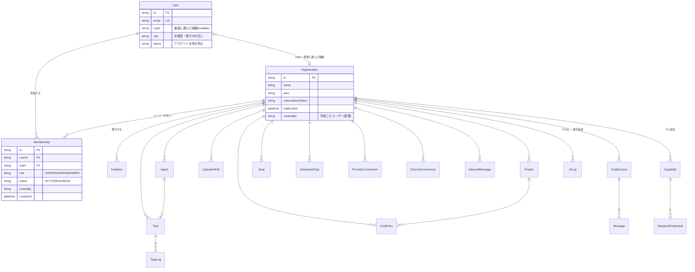
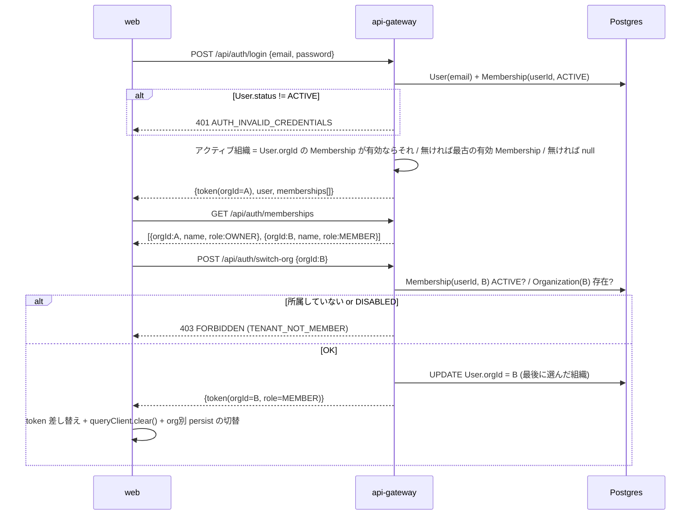
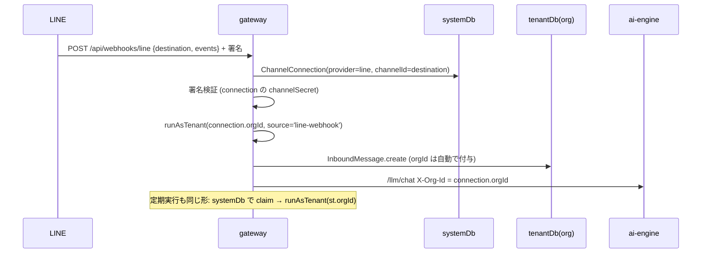

# FLOW マルチテナント設計書

| 項目 | 内容 |
|---|---|
| 状態 | **Phase 1 実装済み**（ブランチ `feat/multi-tenancy`。§14 は推奨案を仮採用・オーナー確認待ち） |
| 作成日 | 2026-11-16 |
| 調査したブランチ | `refactor/cleanup-2026-11`（HEAD `cbfe046`） |
| 対象 | `apps/api-gateway`, `apps/ai-engine`, `apps/web`, `packages/db-schema`, `packages/shared-types` |
| 前提ドキュメント | `CLAUDE.md`, `docs/supabase-migration.md`, `DEPLOYMENT_RUNBOOK.md`, `docs/billing.md` |

> この設計書は現状コードを読んで確かめた事実をもとに書いている。ファイル名と行番号は調査した時点（HEAD `cbfe046`）のもの。
> 推測や未検証のものには **（要確認）** と付けた。
>
> **実装後の追記（2026-11-16）**: 実装で設計から変えた点は §16 にまとめた（コードを正とした）。
> §2 の行番号は調査時点のままで、実装後のコードとはずれている。

---

## 0. 要約（TL;DR）

- **テナント = 既存の `Organization`**。新しく `Tenant` モデルは作らない。
- **`Membership(userId, orgId, role, status)` を足し**、1人のユーザーが複数の組織に入れるようにする。ロールは Membership ごとに持つ。
  `User.orgId` は「最後に選んだ組織」として残し、`User.role` は移行期間中だけ写しとして残す（判定には使わない）。
- **分離方式は今と同じ共有DB + `orgId` 列**のまま。そのうえで **Prisma Client Extension によるテナントスコープ付きクライアント `tenantDb(orgId)`** を入れ、
  routes から素の `prisma` を import できないようにする（アーキテクチャテストで止める）。こうして `orgId` 条件の付け忘れを仕組みで防ぐ。
- **Postgres RLS は段階的に入れる。今回の PR ではポリシーを入れない**（理由は ADR-4）。今の「Data API への蓋としての RLS（ポリシー無し）」はそのまま残す。
  RLS は次の PR（Phase 2）で、`BYPASSRLS` を持たない専用ロールを作ってから導入する。
- **どの組織として動くかは JWT の `orgId` で決める**。組織の切り替えは **`POST /api/auth/switch-org` で新しいトークンを発行する**方式にする。`X-Org-Id` ヘッダ方式やサブドメイン方式は採らない。
  毎リクエストで Membership を確認する（TTL 30 秒のプロセス内キャッシュ付き）。外されたメンバーは 30 秒以内に締め出される。
- **ai-engine には `X-Org-Id` ヘッダで org を伝える**。body の `org_id` と食い違ったら拒否する。強制は `off → warn → enforce` の3段階で切り替える。
- 調査では**今すぐ直すべき穴**も見つかった（§2.4 に E1〜E12 として列挙）。代表的なもの:
  - n8n コールバックは共有トークン1本で全テナントの Task を書き換えられる。しかもトークンの既定値が CLAUDE.md に書いてある。
  - 無効化したユーザーがログインできる。
  - `PATCH /organizations/me` が JWT の role で判定している。

---

## 1. 目的と非目的

### 1.1 目的
1. **1人のユーザーが複数の組織に所属できる**ようにする。用途は、税理士・社労士・コンサルが顧客企業を横断すること、グループ会社、代理店がテナントを代行運用することなど。
2. **組織をまたいだデータ漏えいをアプリの構造で起こりにくくする**。今は「各ハンドラが毎回 `orgId` を書く」規律に頼っている。これを仕組みで強制する形に変える。
3. **認証の無い経路（Webhook・定期実行・n8n コールバック）と ai-engine への伝播**でも、テナントの決め方とチェックを統一する。
4. 組織を分ける検証を **DB 無しで回るテスト**（vitest + prisma モック、pytest）として固定し、回帰を防ぐ。

### 1.2 非目的（§13 に詳しく書く）
- テナントごとに DB やスキーマを分けること（silo 型）。
- SSO / SAML / SCIM。
- テナントごとの暗号鍵（BYOK）。
- n8n 側で管理している資格情報（Gmail / X / シート）のテナント分離。
- usage-metrics-svc（Go）の認証を作り直すこと（問題として挙げるだけ）。

---

## 2. 現状調査（確認した事実）

### 2.1 データモデル（`packages/db-schema/prisma/schema.prisma`）

- `User.orgId String?`（null を許す）と `User.role String @default("MEMBER")`。**1人は1組織にしか属せない**。
  `User.email @unique` は全体で一意。
- `User.status`（`ACTIVE | DISABLED`）はユーザー単位で、組織単位ではない。
- `Invitation` は `orgId` と `role` を持つ。受諾する `POST /api/members/invitations/accept`（`routes/members.ts:166`）は**新しい User を作るだけ**。
  同じメールの User が既にいると 409 を返す（`members.ts:194`）。つまり、既に登録している人を別の組織に招待できない。
- `orgId` 列の有無でモデルを分けると次のとおり。

| 区分 | モデル |
|---|---|
| `orgId` 必須 + Organization への FK あり | ChatSession, Task, UploadedFile, ScheduledTask, Agent, Project, Vendor, CostEntry, Deal, ProviderConnection, ChannelConnection, InboundMessage, Invitation |
| `orgId` 必須だが **FK なし** | AILog, RiskEvent, FileChunk, MessageEmbedding, Capability, CapabilityGap, ExecutionLog |
| `orgId` なし（親を通して所属する） | Message（→ChatSession）, TaskLog（→Task）, RequiredCredential（→Capability） |
| `orgId` が null になりうる（システム用） | BillingEvent |
| 全体で共有（グローバル） | User |

- org を含む一意制約: `Capability @@unique([orgId,name])`, `Agent @@unique([orgId,name])`, `Project @@unique([orgId,code])`, `Vendor @@unique([orgId,name])`, `ProviderConnection @@unique([orgId,provider])`。
- **org をまたいで一意**なもの（意図したもの）: `ChannelConnection @@unique([provider, channelId])`（LINE の destination から逆引きするため）、`InboundMessage @@unique([provider, webhookEventId])`、`Organization.stripeCustomerId / stripeSubscriptionId`。
- **`AILog` には Prisma 側の索引が無い**。`usage-metrics-svc/schema.sql` が `idx_ailog_org_created ("orgId","createdAt")` を Prisma の外で作っているだけ。
  ai-engine の `governance/usage.py` の月間集計と、`routes/organizations.ts` の `/me/usage` の `count` はこの索引を前提にしている。
- migration は手書きで、意図を説明するコメントを付ける流儀（例: `20260912000000_add_members_and_billing_columns/migration.sql`）。

### 2.2 認証と認可（`apps/api-gateway/src/middleware/auth.ts`, `routes/auth.ts`）

- JWT の中身は `{ sub, orgId, role, email }`（`routes/auth.ts:51,81`、`members.ts:235`）。有効期限は `JWT_EXPIRES_IN ?? '24h'`。
- `requireAuth` は `jwtVerify` だけを行う。読み取りでは DB を引かない。書き込み（`needsEntitlementCheck`）のときだけ `organization.findUnique` で契約状態を見る（`auth.ts:38`）。
- `requireRole` は DB の `user` を読み直し、`role/status/orgId` で `request.user` を上書きする（`auth.ts:60-98`）。
  方針として「**JWT の role は判定に使わない**」とコメントに明記されている。
- web 側（`apps/web/src/services/api.ts`）は `Authorization: Bearer` を付け、401 を受けたら logout して `/login` へ遷移する。
  トークンは zustand の persist（key `auth`）、つまり localStorage に置いている。
- **WebSocket**（`GET /api/tasks/:taskId/stream`, `routes/tasks.ts:283-`）は `?token=` か Authorization で検証し、ポーリングのたびに `task.orgId !== payload.orgId` を確認している。
- `request.user as {...}` というキャストは routes に **108 箇所**ある（型付けされたテナント文脈が無い）。

### 2.3 routes/services での orgId の絞り込み（grep の結果）

`prisma.<model>.(findUnique|findFirst|update|delete|upsert)(` を全部抜き出し、where の形で分類した。

**A. `findUnique({ where: { id } })` で取ってから、アプリ側で `x.orgId !== payload.orgId` を見て 404 を返す（後チェック型）。** 今は安全だが壊れやすい。比較を1行消すだけで穴になる。
- `routes/chat.ts:166, 294, 504, 527`（chatSession）
- `routes/scheduled-tasks.ts:28`（assertOwnAgent）, `:99, :132`
- `routes/files.ts:180, 200, 292`
- `routes/tasks.ts:62, 107, 140, 209, 250, 265, 310`
- `routes/sales/pipeline.ts:73, 115`
- `routes/inbox/messages.ts:42`（`loadOwnMessage` 相当）
- `routes/inbox/connections.ts:144`
- `routes/capabilities.ts:299, 352, 392`
- `routes/agents.ts:243, 270, 413, 483, 539`
- `routes/sns/posts.ts:184, 258`

**B. 事前チェックの後の書き込みが `where: { id }` だけ（書き込み自体に org 条件が無い）。**
- `scheduled-tasks.ts:121, 139` / `tasks.ts:117, 186, 256` / `pipeline.ts:134` / `inbox/messages.ts:126, 139, 190` / `capabilities.ts:334, 439` / `inbox/connections.ts:150` /
  `agents.ts:394, 496, 528, 548`（`547` の `scheduledTask.deleteMany({ where: { agentId } })` も） / `accounting/projects.ts:212, 244` / `accounting/vendors.ts:190, 206` /
  `accounting/costs.ts:213, 237` / `sns/posts.ts:206, 233, 266`

**C. 正しい形（`findFirst({ where: { id, orgId } })` / `updateMany({ where: { id, orgId } })`）。** 新しいコードのお手本になる。
- `accounting/projects.ts:149, 208, 231`, `accounting/costs.ts:136, 143, 183, 196, 204, 235`, `accounting/vendors.ts:186, 204`, `governance.ts:61`,
  `members.ts:122, 261, 294` の `updateMany({ where: { id, orgId } })`

**D. もともと org の文脈が無い経路（システム経路）。**
- `routes/webhooks.ts:31, 36, 97, 119, 207`（n8n。共有トークン `x-webhook-token`）
- `services/schedule-dispatcher.ts:75, 84, 88, 93, 166`
- `services/step-runner.ts:403, 415, 524, 533`（再開と、取り残された実行の回収）
- `services/task-executor.ts`（task を引数で受け取る）, `services/inbox/draft-generator.ts:100`, `services/inbox/line-inbox.ts`, `services/lifecycle.ts:38, 57`
- `services/billing/sync.ts`, `routes/billing-webhook.ts:49`

**一覧系（findMany / count / groupBy）** で `orgId` が付いていないのは、親で絞っている `message`（`session: { orgId }` または検証済みの `sessionId`）、`taskLog`、`requiredCredential`、
それに D のシステム経路だけだった。**テナント経路の一覧で、別組織の行が混ざる箇所は見つからなかった。**
生 SQL は `services/rag.ts` の 5 箇所で、どれも `"orgId" = ${orgId}` を持つ（`rag.ts:134-151`）。
添付ファイルの `fileIds` も同じ `WHERE` の中で `orgId` と AND している。

### 2.4 見つかった問題（このPRで直す / 先に直すべきもの）

| # | 場所 | 事実 | 影響 |
|---|---|---|---|
| **E1** | `routes/webhooks.ts:6,18-46` | `/api/webhooks/n8n/task-complete` は共有トークン1本と `taskId` だけで、**どの組織の Task でも** status/output を書き換えられる。トークンの既定値 `'org-ai-n8n-secret-token'` はコードと CLAUDE.md に書かれている | トークンが漏れたら、または既定値のまま運用していたら、全テナントの Task が書き換えられる |
| **E2** | `routes/webhooks.ts:89-102` | `/n8n/queued-tasks` は**全テナント**の QUEUED Task を `input` 込みで返す | 上と同じ条件で、全テナントの入力が読める |
| **E3** | `routes/auth.ts:71` | ログインで `user.status` を見ていない。さらに `requireAuth` も status を見ない | **無効化したメンバーがログインでき**、`requireAuth` だけのルート（チャット・タスク・経理など大半）を使い続けられる |
| **E4** | `routes/organizations.ts:58` | `PATCH /organizations/me` が `payload.role !== 'OWNER'`、つまり **JWT の role** で判定している | auth.ts の方針と食い違う。降格された元オーナーが、トークンの期限まで組織名や請求先を変えられる |
| **E5** | `services/schedule-dispatcher.ts:93` | `agent.findUnique({ where: { id: st.agentId } })` の後、`agent.orgId === st.orgId` を確認していない | 作成時（`scheduled-tasks.ts:69,114` の `assertOwnAgent`）には確認しているので今は起きない。ただ、DB を直接いじったときや将来の経路では、別組織のエージェントの instructions/steps で走りうる |
| **E6** | `services/step-runner.ts:415` | 再開時に `agent.findUnique({ id: task.agentId })` を引き、org を照合していない | E5 と同じ |
| **E7** | `routes/inbox/messages.ts:114` | `channelConnection.findUnique({ id: msg.connectionId })` で org を照合していない | 作る側の構造上は一致しているが、送信用の資格情報を取る経路なので念のため照合しておくべき |
| **E8** | `routes/auth.ts:38-46` | `/register` は Organization と User を作るだけで、**Capability を作らない**。`seed-capabilities.ts` は `ORG_ID=...` を手で渡して流す運用 | 新しい組織が「ノードが1つも無い」状態で始まる。組織を自分で作れるようにするなら必須の課題 |
| **E9** | `AILog`, `RiskEvent` | Organization への FK も Prisma 上の `(orgId, createdAt)` 索引も無い | 月間上限の判定と利用量表示が、Prisma の外の索引に依存している |
| **E10** | `apps/web/src/store/deliverablesStore.ts:145` | persist の key `flow-deliverables-v1` に組織が入っていない。react-query の key（`['org-me']`, `['org-usage']` など）にも org が無い | 組織を切り替えると、前の組織のフォルダ構成やキャッシュが一瞬見えるか、そのまま残る |
| **E11** | `routes/analytics/index.ts:26-33` | usage-metrics-svc に `tenant_id` をクエリで渡し、認証ヘッダは付けていない | svc の URL を知っていれば、任意のテナントの利用統計が読める（要確認: svc 側の認証） |
| **E12** | ai-engine `main.py` 全体 | body の `org_id` / `plan` / `user_email` をそのまま信じる（`ai-engine-auth.ts:7` と `main.py:109` のコメントもそれを認めている）。`plan` でモデル単価が決まり、`user_email` で admin（常に Claude）かどうかが決まる | 内部トークンが漏れると、他組織の AILog を汚せるうえ、高いモデルを無制限に使える |

**対応状況（Phase 1）**: E1〜E7・E9・E10・E12（X-Org-Id の照合まで。plan/user_email を DB で確かめるのは Q5 で見送り）は対応済み。
E8 は組織の作成時に既定のノードを入れるようにした。E11 は記録のみ（スコープ外）。
実装中に**もう1件**見つかった: `services/rag.ts` の再索引前の `DELETE FROM "FileChunk" WHERE "fileId" = …` に org 条件が無かった
（アーキテクチャテスト A2 で検出し修正）。

補足:
- n8n が生成するワークフローの ai-engine 呼び出しノード（`services/n8n-workflow-builder.ts:115-117, 209`）は `Content-Type` しか送っていない。
  そのため `INTERNAL_API_TOKEN` を設定すると、n8n 経由の `/llm/chat` は 401 になり、AI Engine フォールバックで完走する（要確認: 本番で実際にそうなっているか）。
- OAuth Google の `/confirm`（`routes/oauth-google.ts:230-`）は「confirm したときのセッションの orgId」に保存する設計で、state に orgId を入れない。これは正しい。
  ただし組織を切り替えられるようになると、**start と confirm の間に切り替えた場合、切り替えた先に保存される**。§10 で UI 側から防ぐ。

### 2.5 ai-engine（`apps/ai-engine/app`）

- `main.py:114-138`: `INTERNAL_API_TOKEN` が設定されていれば `X-Internal-Token` を `secrets.compare_digest` で照合する。未設定なら素通しする。
- どのリクエストモデルにも `org_id: str` と `plan: str = "STARTER"` があり、多くは `user_email` も持つ（`PlanRequest` など）。
- `db.py`: SQLAlchemy async で **同じ `DATABASE_URL` に直接つなぐ**（asyncpg）。
- 書き込みは `governance/audit_logger.py`（AILog / RiskEvent の INSERT）、読み取りは `governance/usage.py:58-66`（`SELECT count(*) FROM "AILog" WHERE "orgId" = :org AND createdAt >= 当月`）。
- `usage.py` は org_id ごとにプロセス内で 60 秒キャッシュし、`note_call` で増やす。判定は LLMRouter（`llm/router.py:208-257`）の1か所だけ。
- テストは pytest で、DB 無しで回す（`tests/test_usage_limits.py` は fixture `tests/fixtures/plan-models.json` を正本として、gateway 側と同じ値を検証している）。

### 2.6 web（`apps/web/src`）

- `store/authStore.ts`: `{ user, token, login, logout }` だけ。所属組織の一覧は持っていない。
- `components/shell/Sidebar.tsx:90-105`: **「組織を切り替え」という aria-label 付きのボタンが既にある**（`ChevronsUpDown` アイコン付き）。ただし onClick が無く、何も起きない。
  組織名とプランは `GET /organizations/me`（queryKey `['org-me']`）から出している。
- 設定ページ `pages/SettingsPage.tsx` のタブは `general | members | integrations | billing`。メンバー管理は `components/Settings/MembersSection.tsx`。
- 招待を受ける画面は `pages/InvitePage.tsx`。
- `main.tsx` で `QueryClient` を1つ作っている（組織を切り替えたら `queryClient.clear()` すれば済む）。

### 2.7 DB 接続（Supabase）

- `docs/supabase-migration.md` と `DEPLOYMENT_RUNBOOK.md`: gateway・ai-engine・n8n はどれも **Session pooler（Supavisor, :5432）**、ユーザー `postgres.<project-ref>` で接続する。
  transaction pooler（:6543）は Prisma の migrate で advisory lock を保てないので使わない。
- 同じ文書 §6: `public` の全テーブルで **RLS を有効にしてあり、ポリシーは置いていない**（Data API を塞ぐための蓋）。
  「所有者ロールは RLS をバイパスするのでアプリは壊れない」と検証済み。「独自 JWT なので RLS ポリシーは書かないこと」とも明記されている。
- `utils/prisma.ts`: PrismaClient は1つだけで、`$extends` は使っていない。Prisma のバージョンは **5.22.0**（package-lock）。
  `$extends` の query 拡張と、`findUnique` の where に一意でない列を足せる機能（extendedWhereUnique、5.0 で GA）はどちらも使える。

### 2.8 組織ごとの資源の現状（論点5）

| 資源 | 保存先 | org 単位か | 不足 / 今回やること |
|---|---|---|---|
| プラン | `Organization.plan` | ✅ | ai-engine は body の `plan` を信じている（E12）→ ai-engine で DB を読むか検討（Q5） |
| サブスク・Stripe | `Organization.stripe*` / `subscriptionStatus` ほか | ✅ | 組織を自分で作れるようになると、**トライアルが組織ごとに1回 → 組織を作るたびにトライアル**になる（Q3） |
| ストレージの容量と使用量 | `Organization.storageUsedBytes / storageAddonUnits`、キー `"{orgId}/..."` + `keyBelongsToOrg`（`services/storage/index.ts:44`） | ✅ | 変更なし |
| AI 月間上限 | ai-engine `usage.py` が AILog を orgId で数える | ✅ | AILog の索引を Prisma migration に取り込む（E9） |
| 部署 | コード定数 `AGENT_DEPARTMENTS`（`shared-types/src/index.ts:137`） | ➖（全組織共通） | 組織ごとの部署定義は**スコープ外** |
| エージェント | `Agent`（`@@unique([orgId,name])`） | ✅ | n8n ワークフロー `agent-<id>` は n8n インスタンス1つを共有している。id が全体で一意なので衝突はしない |
| Capability（ノード） | `Capability`（`@@unique([orgId,name])`） | ✅ | **新しい組織にノードが作られない**（E8）→ 組織作成時に作る |
| 連携の資格情報（Slack / Google） | `ProviderConnection`（暗号文 `accessTokenEnc` など） | ✅ | 暗号鍵は全体で1本（`CHANNEL_CREDENTIAL_ENC_KEY`）。`secret-box.ts` は AAD を使っていない → orgId を AAD にするのは Phase 2（Q8） |
| LINE 資格情報 | `ChannelConnection` | ✅ | 同上 |
| n8n 管理の資格情報（Gmail / X / シート） | n8n の credential | ❌（運営者のもの1つ） | **スコープ外**。ただしマルチテナントで売るときの障害なので明記する |
| 組織の設定 | `Organization.name / billingEmail` | ✅ | `CAPABILITY_CONFIDENCE_THRESHOLD` などは環境変数で全体共通のまま（スコープ外） |
| admin 判定 | 環境変数 `ADMIN_EMAILS` × JWT の email | ➖（ユーザー単位） | 変更なし。ただし ai-engine には JWT 由来の email しか渡さない（body を信じない） |
| 招待 | `Invitation.orgId` | ✅ | 既存ユーザーも受諾できるようにする |
| 監査ログ | `AILog / RiskEvent.orgId` | ✅ | 書くのは ai-engine だけ（`a9ab0ec` で一本化済み） |

---

## 3. ユースケース

1. **UC1 オーナーが2つ目の会社を作る**: 建設会社 A の社長が関連会社 B を作る。サイドバーの組織スイッチャーから「新しい組織を作成」→ B のオーナーになり、トークンは B 用に切り替わる。A のデータは B から一切見えない。
2. **UC2 既存ユーザーを別の組織に招待する**: 税理士 T（既に事務所 X の利用者）を、A のオーナーが MEMBER として招待する。T はリンクを開いてログインし「参加」するだけ（新しいアカウントは作らない）。T はスイッチャーで X と A を行き来する。
3. **UC3 組織によってロールが違う**: T は X では OWNER、A では MEMBER。A ではメンバー管理の画面が出ず、API も 403 を返す。
4. **UC4 1つの組織からだけ外す**: A のオーナーが T を無効化する。T の A 用トークンは最大 30 秒で 403（`TENANT_ACCESS_REVOKED`）になる。X は今までどおり使える。
5. **UC5 認証の無い経路**: LINE webhook は destination から、Stripe webhook は metadata.orgId / customerId から、定期実行は `ScheduledTask.orgId` から組織を決める。その組織のスコープで処理し、ai-engine にも同じ org が伝わる。
6. **UC6 攻撃者が ID を推測する**: A の MEMBER が、B の `Task` / `CostEntry` の id を URL に入れて GET/PUT/DELETE する。どれも 404 で、書き込みは0件。一覧にも混ざらない。
7. **UC7 所属組織が無いユーザー**: 唯一の所属組織から外されたユーザーがログインする。「所属している組織がありません。招待を受けるか、新しい組織を作成してください」と出て、それ以外の API は 403 になる。

---

## 4. 用語集

| 用語 | 意味 |
|---|---|
| テナント / 組織 | `Organization` の1行。データの分離とプラン・課金の単位 |
| ユーザー（アカウント） | `User` の1行。全体で共有する本人（email は全体で一意）。ログイン資格情報を持つ |
| メンバーシップ | `Membership(userId, orgId)`。所属とロールと状態を持つ。**権限の正本** |
| アクティブ組織 | いま操作対象にしている組織。JWT の `orgId` がそれにあたる |
| 最後に選んだ組織 | `User.orgId`（列名は残し、意味だけ変える）。次にログインしたときの既定の組織 |
| テナントコンテキスト | リクエスト（またはジョブ）ごとの `{ orgId, userId?, role?, source }`。`request.tenant` と AsyncLocalStorage に置く |
| テナントクライアント | `tenantDb(orgId)`。orgId 条件を自動で付ける Prisma の拡張クライアント |
| システムクライアント | `systemDb`。全テナントを横断してよい処理（スケジューラ、webhook の逆引き、回収処理）専用の素の Prisma |
| テナントモデル | `orgId` 列を持つモデル（§2.1 の上の2行）。テナントクライアントが自動でスコープを付ける |
| 子モデル | `orgId` を持たず、親を通して所属するモデル（Message, TaskLog, RequiredCredential） |
| 内部トークン | gateway → ai-engine の共有シークレット `INTERNAL_API_TOKEN`（ヘッダ `X-Internal-Token`） |

---

## 5. 図

### 5.1 ER 図（変更後。主要な部分だけ）



### 5.2 シーケンス: ログイン → 組織の切り替え



### 5.3 シーケンス: 認証付きリクエスト → ai-engine

```mermaid
sequenceDiagram
    participant W as web
    participant G as gateway (requireAuth/tenant)
    participant C as Membership cache (30s)
    participant DB as Postgres
    participant AI as ai-engine
    W->>G: POST /api/chat/sessions/:id/messages (Bearer orgId=A)
    G->>G: jwtVerify
    G->>C: get(userId, A)
    alt cache miss
        C->>DB: Membership(userId,A) + User.status + Org.subscriptionStatus
    end
    alt 所属なし / DISABLED
        G-->>W: 403 TENANT_ACCESS_REVOKED
    end
    G->>G: request.tenant = {orgId:A, role, userId}; ALS.run(...)
    G->>DB: tenantDb(A).chatSession.findUnique({id}) → WHERE id=? AND orgId=A
    G->>AI: POST /orchestrate  headers: X-Internal-Token, X-Org-Id: A  body: {org_id: A, ...}
    AI->>AI: token 照合 → X-Org-Id と body.org_id の一致確認 → ContextVar(org=A)
    AI->>DB: INSERT AILog(orgId=A) / usage count(orgId=A)
    AI-->>G: 結果
    G-->>W: 200
```

### 5.4 シーケンス: 認証の無い経路（LINE webhook / 定期実行）



---

## 6. ルールと不変条件

**データ**
- **I1** テナントモデルの行はどれも、作ったときから `orgId` を持ち、**変わらない**（`orgId` を更新するコードを置かない。テナントクライアントが update の `data.orgId` を拒否する）。
- **I2** 子モデル（Message / TaskLog / RequiredCredential）は、**同じテナントクライアントで親を取れたときにだけ**読み書きしてよい。
- **I3** 別の行を指すもの（`Task.agentId`, `ScheduledTask.agentId`, `CostEntry.projectId/vendorId`, `InboundMessage.connectionId`）は、**指す先が同じ orgId** であること。
  書く側では `assertSameOrg` で確かめ、読む側（E5/E6/E7）でも照合する。
- **I4** `Membership` は `(userId, orgId)` で一意。ACTIVE な OWNER がいなくなる更新は拒否する（どの組織にも ACTIVE OWNER が最低1人いる）。
- **I5** `Organization` は物理削除しない（今と同じ。削除の機能はスコープ外）。

**認証と認可**
- **I6** 権限の判定には **Membership.role** を使う。JWT の `role` は表示用で、判定には使わない（今の方針を Membership に移すだけ）。
- **I7** JWT の `orgId` は「そのトークンが操作してよい唯一の組織」。リクエストごとに `Membership(sub, orgId)` が ACTIVE であることを確かめる（30 秒キャッシュ）。
- **I8** `User.status = DISABLED` ならどの組織にも入れない（ログインも拒否）。`Membership.status = DISABLED` ならその組織にだけ入れない。
- **I9** body / query / header で `orgId` を受け取って、操作する組織を決めることはしない（招待の受諾は `Invitation.orgId`、切り替えは Membership の検証が要る）。

**経路**
- **I10** routes から `utils/prisma` の `prisma` を直接 import しない。使えるのは `request.tenant.db` だけ。システムクライアントを使ってよいファイルは allowlist で固定する。
- **I11** gateway から ai-engine への呼び出しはすべて `aiEngineHeaders()` を通し、`X-Org-Id` を付ける。body の `org_id` は同じ値にする。
- **I12** ai-engine は、`X-Org-Id` と body の `org_id` が食い違うリクエストを処理しない（enforce モードのとき）。

**エラー**
- 他組織の id を指定された場合は **404 `NOT_FOUND`**（存在を漏らさない。今と同じ）。
- 所属していない組織への切り替えは **403 `TENANT_NOT_MEMBER`**。
- トークンの org から外された場合は **403 `TENANT_ACCESS_REVOKED`**。web は「この組織へのアクセス権がなくなりました」と出し、所属組織の一覧へ戻す。401 にはしない（ログアウトさせない）。
- ai-engine で org が食い違った場合は **403 `ORG_MISMATCH`**（理由は細かく返さない）。
- 形式は今と同じ `{ success: false, error: { code, message } }`。

---

## 7. アーキテクチャ

### 7.1 api-gateway

```
apps/api-gateway/src/
├── utils/prisma.ts                # 既存。素の PrismaClient（= systemDb の実体）。名前は残す
├── tenancy/
│   ├── context.ts                 # AsyncLocalStorage<TenantContext>, runAsTenant(), currentTenant()
│   ├── tenant-db.ts               # tenantDb(orgId): Prisma $extends でスコープを付ける
│   ├── tenant-models.ts           # TENANT_MODELS / CHILD_MODELS / GLOBAL_MODELS の表
│   ├── membership-cache.ts        # (userId, orgId) → {role, status} の TTL 30 秒 LRU
│   └── assert-same-org.ts         # I3 の確認ヘルパ
├── middleware/auth.ts             # requireAuth = jwtVerify + テナント解決。requireRole は Membership を見る
└── routes/auth.ts                 # + GET /memberships, POST /switch-org
    routes/organizations.ts        # + POST / （組織の作成）, GET /mine は /auth/memberships に寄せる
```

#### 7.1.1 テナントコンテキスト

```ts
// tenancy/context.ts
export interface TenantContext {
  orgId: string;
  userId: string | null;        // システム経路では null
  role: UserRole | null;        // Membership.role（システム経路では null）
  source: 'http' | 'line-webhook' | 'stripe-webhook' | 'n8n-callback' | 'scheduler' | 'recovery';
  db: TenantDb;                 // tenantDb(orgId)
}
const als = new AsyncLocalStorage<TenantContext>();
export function runAsTenant<T>(ctx: Omit<TenantContext, 'db'>, fn: () => Promise<T>): Promise<T>;
export function currentTenant(): TenantContext | undefined;
```

- **ハンドラは `request.tenant`**（`app.decorateRequest('tenant', null)`）を**明示的に**使う。理由は2つ。既存のテストが `request` を手で組み立てる流儀（`auth.test.ts` の `makeReq`）で、明示的な引数のほうがモックしやすい。それに、暗黙の ALS が空のときに素通りする事故を避けたい。
- **ALS は横断的な関心事にだけ使う**。具体的には3つ:
  1. `aiEngineHeaders()` が `X-Org-Id` を自動で付ける。
  2. ログに `orgId` を載せる（Fastify の `request.log.child({ orgId })` と、`console.*` を使っている services 向けの `logTenant()`）。
  3. `void runAgentTask(...)` のように**リクエストの外で続く処理**に org を引き継ぐ。ALS は Promise の継続に伝わるので、リクエスト中に起動した処理は自動で同じ org を持つ。
- システム経路（スケジューラ、webhook、起動時の回収）は、org が決まった時点で `runAsTenant({ orgId, source })` で包む。

#### 7.1.2 テナントクライアント `tenantDb(orgId)`

Prisma 5.22 の `$extends({ query: { $allModels: { $allOperations } } })` で作る。

| 操作 | 書き換え |
|---|---|
| `findMany / findFirst / findFirstOrThrow / count / aggregate / groupBy / updateMany / deleteMany` | `args.where = { AND: [args.where ?? {}, { orgId }] }` |
| `findUnique / findUniqueOrThrow / update / delete` | `args.where = { ...args.where, orgId }`（extendedWhereUnique。`id` だけの一意検索に `orgId` を足せる）。見つからなければ `null` / P2025 → 呼び出し側で 404 |
| `create` | `args.data.orgId` が無ければ付ける。あって違う値なら `TenantViolationError` を投げる |
| `createMany` | 各行に同じ処理 |
| `upsert` | `where` に orgId を足し、`create.orgId` を付けて照合する。`update.orgId` は拒否 |
| `update / updateMany` の `data.orgId` | 拒否（I1） |
| 子モデル（Message / TaskLog / RequiredCredential） | **書き換えない**。I2 は呼び出し側の規律で守り、テストで固定する。Phase 2 で `orgId` 列を足すかを決める（Q7） |
| グローバルモデル（User / Organization / BillingEvent） | `User` と `Organization` は `id = ctx.orgId` などに限った**読み取り専用のファサード**（`db.currentOrg()` / `db.members()`）を出す。素のモデルは見せない（型から外す） |
| `$queryRaw / $executeRaw` | 拡張では書き換えられない。**raw を許すのは `services/rag.ts` と `routes/files.ts`（容量の減算）だけ**とし、アーキテクチャテストで「`"orgId"` を含むこと」を検査する |

- **include / select のネスト**（例: `task.findUnique({ include: { logs } })`）は、親が絞られていれば子も同じ org になる（I2）。追加の処理は要らない。
- **ネストの書き込み / `connect`** で他テナントの id を指す危険がある（例: `task.create({ data: { agentId } })`）。拡張はこれを検出できない。そこで `assertSameOrg(db, 'agent', agentId)` を書く側で呼ぶ（I3）。DB の複合 FK で強制する案は ADR-6 で検討した。
- **性能**: `$extends` は接続プールを共有する軽いラッパー。リクエストごとに作っても新しい接続は張らない。気になるなら `orgId` 単位で LRU に保持してもよい（要確認: ベンチを1回取る）。
- **トランザクション**: `routes/files.ts:130, 320` と `routes/members.ts:206` の `$transaction(async (tx) => …)` は、`tenantDb` の `$transaction` を使うと `tx` も拡張済みになる（要確認: 5.22 で interactive tx の中に拡張が伝わるか、テストで固定する）。

#### 7.1.3 `requireAuth` / `requireRole` の新しい形

```ts
export async function requireAuth(req, reply) {
  await req.jwtVerify()                                      // 失敗 → 401（今と同じ）
  const { sub, orgId } = req.user
  if (!orgId) return deny(403, 'TENANT_REQUIRED')            // 所属組織なし（UC7）。許可リストの経路は除く
  const m = await membershipCache.get(sub, orgId)            // Membership + User.status + Org.subscriptionStatus を1クエリで
  if (!m || m.userStatus !== 'ACTIVE') return deny(401, 'AUTH_REQUIRED')      // アカウントの停止（E3 も塞ぐ）
  if (m.status !== 'ACTIVE') return deny(403, 'TENANT_ACCESS_REVOKED')
  if (needsEntitlementCheck(...) && entitlementOf(m.subscriptionStatus) === 'read_only') return deny(402, ...)
  req.tenant = { orgId, userId: sub, role: m.role, source: 'http', db: tenantDb(orgId) }
  als.enterWith(req.tenant)  // または onRequest フックで als.run
}
export const requireRole = (r) => async (req, reply) => {
  await requireAuth(req, reply); if (reply.sent) return
  const fresh = await membershipCache.get(req.user.sub, req.tenant.orgId, { bypassCache: true })  // 危険な操作では必ず DB を読む（今の思想と同じ）
  if (!hasRoleAtLeast(fresh.role, r)) return deny(403, 'FORBIDDEN')
}
```

- **読み取りでも DB を1回引くことになる**。今の auth.ts は「読み取りでは DB を引かない」と明記しているので、これは方針の変更になる（Q1）。
  緩和策は次のとおり。30 秒 TTL のプロセス内キャッシュを置く（Render の api-gateway は1インスタンス。台数を増やしても TTL 分の遅れで済む）。キャッシュが外れたときは `Membership ⨝ User ⨝ Organization` を主キー引きで1回だけ読む。今の書き込み時の契約チェック（`organization.findUnique`）はこの1回に吸収する。
  Membership を変える API（役割の変更・無効化・削除）は、同じプロセスのキャッシュを**即座に破棄**する。
- `PATCH /organizations/me`（E4）は `requireOwner` にする。

#### 7.1.4 システム経路のテナント解決

| 経路 | 今の決め方 | 新しい扱い |
|---|---|---|
| LINE webhook `/api/webhooks/line` | `ChannelConnection(provider, channelId=destination)`（`line-webhook.ts:43`） | `systemDb` で逆引き → 署名検証 → `runAsTenant(connection.orgId, 'line-webhook')`。以降の `processLineEvents` / `draft-generator` / `receipt-capture` は `currentTenant().db` を使う |
| Stripe webhook `/api/webhooks/stripe` | `metadata.orgId` → `stripeCustomerId`（`billing/sync.ts:53-62`） | 変更なし（Organization 自体を更新するシステム処理。`systemDb` の allowlist に入れる）。署名検証済みなので metadata は信じてよい |
| 定期実行（内部 tick + n8n `/n8n/scheduled-jobs` / `/n8n/enqueue-scheduled-task` / `/n8n/scheduled-job-complete`） | `ScheduledTask` の全件スキャン → claim | claim と候補のスキャンは `systemDb`。claim した後は `runAsTenant(st.orgId, 'scheduler')`。agent は `db.agent.findUnique({id})` で引く（自動で orgId が付くので E5 が直る） |
| n8n `/n8n/task-complete`, `/n8n/task-log` | 共有トークン + taskId | **body に `orgId` を必須にし**、`task.orgId === orgId` を照合する（E1）。n8n ワークフローの生成時に `orgId` をコールバック body に埋め込む（`n8n-workflow-builder.ts`）。トークンが既定値のまま本番で起動したら起動時に警告し、`NODE_ENV=production` なら拒否する（Q6） |
| n8n `/n8n/queued-tasks` | 全テナントの QUEUED | 返すのを `id, orgId` だけにし、`input` は返さない（E2）。使っていないなら廃止する（要確認: 今の n8n ワークフローがこのポーリングを使っているか） |
| 起動時の回収（`recoverStaleRunningTasks`, `lifecycle.ts`） | 全件 updateMany | `systemDb` のまま（状態を FAILED にするだけで、中身は読まない） |
| step-runner の再開（`resumeAgentTask`） | `task.findUnique({id})` | 呼び出し元の承認 API（テナント経路）から `orgId` を渡し、`db.task` / `db.agent` で引く（E6） |
| OAuth Google callback | state の署名だけ（org を持たない） | 変更なし。`/confirm` で保存先の組織をトークンの orgId に決める（今と同じ）。UI 側で §10 の対策をする |
| 招待のプレビュー / 受諾 | `Invitation.tokenHash` | 変更なし（`systemDb`）。受諾したら Membership を作る |

### 7.2 ai-engine

- **伝え方**: gateway の `aiEngineHeaders()` が ALS から `X-Org-Id` を付ける（呼び出し元がテナントコンテキストの外なら付けずに警告ログを出す）。body の `org_id` は今のまま送る（後方互換）。
- **確認**: `main.py` のミドルウェアで `X-Org-Id` を取り出し、`contextvars.ContextVar('org_id')` に置く。各エンドポイントの先頭（8 箇所: `/orchestrate`, `/orchestrate/stream`, `/llm/chat`, `/plan`, `/rank`, `/vision/receipt`, `/plan/http-node`, `/plan/agent`）で `bind_org(request.org_id)` を呼ぶ。
  ```python
  def bind_org(body_org_id: str) -> str:
      header = current_org_header.get()
      mode = ORG_HEADER_MODE  # 'off' | 'warn' | 'enforce'（環境変数。既定 warn）
      if header and header != body_org_id:  -> 403 ORG_MISMATCH（warn でも不一致は拒否する。正規の gateway は食い違いを作らない）
      if not header and mode == 'enforce':  -> 403 ORG_MISMATCH
      if not header and mode == 'warn':     -> logger.warning（n8n 経由などの洗い出し用）
      current_org.set(body_org_id); return body_org_id
  ```
  body と ContextVar の両方を持たせるのは、既存の関数シグネチャ（`org_id=request.org_id` を下へ渡す多くの呼び出し）を変えずに済ませるため。
- **n8n 経由**: `n8n-workflow-builder.ts` が生成する AI Engine ノードに `X-Internal-Token` と `X-Org-Id`（gateway が webhook body に入れた `orgId` を参照する式）を足す。今のワークフローは再生成が要る（`n8nStatus=PENDING` に戻して作り直す既存の仕組みを使う）。
- **使う場面**: `audit_logger.log_llm_call` と `usage.monthly_calls/note_call` は引数の `org_id` を使い続ける。`assert org_id == current_org.get()` を**防御のアサーション**として入れる（食い違ったら記録をやめ、警告を出す）。ログのフォーマッタにも `org_id` を足す。
- **`plan` / `user_email` を信じない件（E12）**: 第1段では今のまま body を使う。第2段で ai-engine が `Organization.plan` を DB から読む（`usage.py` と同じ 60 秒キャッシュ）ようにし、body の plan より DB を優先する（Q5）。`user_email` は gateway が JWT 由来の値だけを入れていることをテストで固定する。

### 7.3 web（§10 に詳しく）

- `authStore` に `memberships: MembershipSummary[]` と `activeOrgId` を足す。
- `switchOrg(orgId)` は `POST /auth/switch-org` → トークンの差し替え → `queryClient.clear()` → 組織別 persist の再読み込み → `/` へ遷移。

---

## 8. 主要な判断（ADR）

### ADR-1: テナントは既存の `Organization` を使う
- **状況**: テナントを表すモデルが要る。今の全テナントモデルは `orgId → Organization` を持っている。
- **選択肢**
  1. **Organization をそのままテナントとして使う**
  2. `Tenant` を新しく作り、Organization をその下に置く（1テナントに複数組織）
- **比較**: 2 を選ぶとすべての `orgId` を `tenantId` に移すか、2段の階層を持つことになり、migration・コード・課金（Stripe は組織に紐づいている）が全部変わる。
  2 が必要になるのは「グループ会社をまとめて請求する」「親テナントが子組織を管理する」場合だけで、今のユースケース（§3）には無い。
- **決定**: **1**。将来グループ請求が要るときは、`Organization.parentOrgId` か `BillingAccount` を足せば対応でき、今回の判断はそれを妨げない。
- **結果**: スキーマの変更は Membership を足すことだけに絞れる。

### ADR-2: Membership を足して、ロールはそこで持つ
- **状況**: `User.orgId / User.role` は1人1組織。`User.email` は全体で一意なので、「組織ごとにアカウントを作る」こともできない（招待が 409 になる、`members.ts:194`）。
- **選択肢**
  1. **Membership テーブルを足し、User はグローバルな本人にする**
  2. 組織ごとに User 行を作れるよう email の一意性を `(email, orgId)` にする
- **比較**: 2 はパスワードが組織の数だけでき、ログインで「どの組織の自分か」を選ぶ UI が要る。`Agent.createdBy` などの監査（User.id 参照）も人単位で辿れなくなる。
- **決定**: **1**。
  - `Membership { id, userId, orgId, role, status, invitedBy?, createdAt, updatedAt, @@unique([userId, orgId]), @@index([orgId, status]) }`
  - `User.orgId`: 列名は**残し**、意味を「最後に選んだ組織」に変える（schema のコメントで明示する）。名前を変えるのは Phase 3（Q9）。残す理由は3つ。①ロールバックでそのまま使える ②`requireRole` が今読んでいる ③後方互換のための読み取りがある。
  - `User.role`: **非推奨**。移行期間中は Membership.role を変えるときに、`User.orgId` が同じ組織なら写しとして書く（二重書き込み）。判定には使わない。Phase 3 で落とす。
  - `User.status`: アカウント全体の停止（運営者用）。メンバー管理画面の「無効化」は **Membership.status** を変えるように直す。今の `PATCH /members/:userId/status`（`members.ts:278-305`）は User.status を変えているので、そのままだと他の組織からも締め出してしまう。
- **結果**: ログイン・招待・メンバー管理・requireRole を Membership に向け直す。

### ADR-3: テナント解決は JWT の orgId にし、切り替えはトークンの再発行で行う
- **選択肢**

| 観点 | A. 切り替え API で新しいトークンを発行 | B. `X-Org-Id` ヘッダ（トークンは全組織共通） | C. サブドメイン（`a.flow.app`） |
|---|---|---|---|
| 漏れたときの影響 | トークン1本につき1組織 | 1本で全所属組織に届く | 1本で全組織（B と同じ。ホスト名で選ぶだけ） |
| リクエストごとの検証 | Membership(sub, orgId) | Membership(sub, header) が必ず要る | B と同じ + Host の解析 |
| 既存コードへの影響 | `request.user.orgId` の意味が変わらない。108 箇所はそのまま動く | 全ハンドラで orgId の出どころが変わる | B + CORS（`index.ts` の origin 判定）・Vercel のワイルドカードドメイン・Cookie の範囲 |
| WebSocket / `?token=` | そのまま | クエリに org を足す必要がある | Host を見る |
| タブごとに別の組織 | できない（localStorage は共有） | できる（sessionStorage に org を置けば） | できる |
| インフラ | 不要 | 不要 | DNS・TLS ワイルドカード・Vercel の設定 |

- **決定**: **A**。漏れたときの影響が小さく、既存の `request.user.orgId` の意味（JWT 由来のアクティブ組織）がそのまま保てるので、変更が最小で済む。
  タブごとに別の組織を開けないのは制約として受け入れる（中小企業の利用ではまれ。別タブで切り替えると、もう一方のタブは次のリクエストで新しいトークンを使い、組織が変わる）。
  この挙動は web 側で `storage` イベントを受け、「別のタブで組織が切り替わりました」と出して再読み込みすることで分かりやすくする。
- **トークンの中身**: `{ sub, orgId, role(表示用), email, typ: 'access' }`。期限は今と同じ `JWT_EXPIRES_IN`。
- C は「顧客ごとの独自ドメイン」が要件になったら再検討する（スコープ外）。

### ADR-4: Postgres RLS は段階的に入れる（今回の PR ではポリシーを入れない）
- **状況**: アプリ層で強制するだけでは、raw SQL・ai-engine（SQLAlchemy で直接つなぐ）・将来の新しい経路での付け忘れは防げない。多層防御として RLS を検討した。
- **事実と制約**
  1. gateway と ai-engine は `postgres.<ref>`（Supabase の `postgres` ロール）で Session pooler につないでいる。`docs/supabase-migration.md` §6 で「所有者ロールは RLS をバイパスする」と検証済み。
     **テーブル所有者は `FORCE ROW LEVEL SECURITY` を付けない限りポリシーを受けない**。さらに Supabase の `postgres` ロールは `BYPASSRLS` を持っている可能性が高い（**要確認**: `SELECT rolbypassrls FROM pg_roles WHERE rolname = current_user;`）。
     → 今の接続ユーザーのままポリシーを書いても効かない。**`NOBYPASSRLS` の専用ロール（例: `flow_app`）を作り、テーブルの GRANT と接続文字列を分ける**ことが前提になる。
  2. ポリシーは `USING ("orgId" = current_setting('app.org_id', true))` の形になる。Prisma で値を渡すには、**操作ごとに `$transaction([ $executeRaw\`SELECT set_config('app.org_id', ${orgId}, true)\`, 本体 ])`** で包む必要がある（`SET LOCAL` / `set_config(..., true)` はトランザクションの中でしか効かず、Prisma は操作ごとにプールの別の接続を使いうるため）。
     - 今の Session pooler（Supavisor のセッションモード）なら、トランザクションの中で同じサーバ接続が保たれるので**動くこと自体は動く**。将来 transaction pooler（:6543）に移っても、トランザクション内の `set_config(…, true)` は保たれる。危ないのは `SET`（セッションスコープ）を使った場合で、プールの接続に値が残って**次の別テナントの要求に漏れる**。なので `SET` は使わない。
     - コスト: すべての操作が「BEGIN / set_config / 本体 / COMMIT」の4往復になる。Render（オレゴン）と Supabase us-west-2 の間の RTT ぶんが積み上がる（要確認: 計測）。
     - 既存の interactive transaction（`files.ts:130,320`, `members.ts:206`）は、先頭で set_config を呼ぶ形に直す必要がある。
  3. システム経路（スケジューラ、webhook の逆引き、回収、migrate）は全テナントを横断するので、`BYPASSRLS` の別ロールで**2本目の接続文字列**が要る。Session pooler の接続数の枠を2つのプールで分け合うことになる（要確認: 今のプランのプールサイズ）。
  4. ai-engine（asyncpg）も同じ `set_config` を入れる必要がある。AILog への INSERT は1文なので、トランザクションで包めば済む。
  5. `CLAUDE.md` / `supabase-migration.md` には「RLS ポリシーは書かないこと」とあり、運用手順（Supabase の SQL エディタで手作業）も変わる。
- **選択肢**: (a) 今回入れる (b) **段階的に入れる** (c) 見送る
- **決定**: **(b) 段階導入**。
  - **Phase 1（この PR）**: アプリ層の強制（tenantDb + アーキテクチャテスト + 分離テスト）だけ。今の「ポリシー無し RLS = Data API の蓋」はそのまま。
  - **Phase 2（別の PR）**: `flow_app`（NOBYPASSRLS）/ `flow_system`（BYPASSRLS）のロールを作る → まず **AILog / RiskEvent / FileChunk / MessageEmbedding**（raw SQL と ai-engine が触る、つまりアプリ層の強制が効かない表）にだけポリシーを入れる → 計測 → 残りの表へ広げる。
  - **見送り（c）にしない理由**: ai-engine と raw SQL はアプリ層の拡張の外にあり、ここを守れるのは RLS だけ。
  - **今回入れない（a にしない）理由**: 上の 1 と 3（ロールと接続文字列を分けること）が本番の Supabase と Render の設定変更を伴う。アプリの改修と同じ PR に載せると、ロールバックの単位が大きくなりすぎる。
- **結果**: Phase 1 の tenantDb は、Phase 2 で「`$allOperations` の中で `set_config` + 本体を batch transaction にする」ように中身だけ差し替えられる形で作っておく（呼び出し側は変えない）。

### ADR-5: routes から素の prisma を使わせない（アーキテクチャテストと ESLint で止める）
- **選択肢**: ESLint の `no-restricted-imports` / **vitest のアーキテクチャテスト** / 規約だけ
- **事実**: 調査時点では api-gateway に ESLint は無かった。実装時点のブランチにはルートの `eslint.config.js` が入っていたので、
  **両方**で止める（ESLint の `no-restricted-imports` で `src/routes/**` からの `utils/prisma` を禁止し、allowlist は `ignores`。
  サービスを含む全体の allowlist はアーキテクチャテスト側に理由付きで持つ）。
- **決定**: **vitest のアーキテクチャテスト**（`src/__tests__/architecture.test.ts`）。`src/routes/**` と `src/services/**` を読んで、`from '../utils/prisma'` / `'../../utils/prisma'` の import が **allowlist** のファイルにしか無いことを検査する。DB 無しで回り、既存の `npm test` に乗る。
  - allowlist（システム経路）: `routes/webhooks.ts`, `routes/inbox/line-webhook.ts`, `routes/billing-webhook.ts`, `routes/members.ts`（招待のプレビューと受諾だけ。分けられるなら `routes/invitations-public.ts` に切り出す）, `routes/auth.ts`, `services/schedule-dispatcher.ts`（claim だけ）, `services/billing/*`, `services/lifecycle.ts`, `services/step-runner.ts`（`recoverStaleRunningTasks` だけ）, `middleware/auth.ts`, `tenancy/*`, `index.ts`（`/ready`）。
  - raw SQL（`$queryRaw|$executeRaw`）は `services/rag.ts` と `routes/files.ts` だけ。どちらも `"orgId"` か `"Organization"` を含むこと。

### ADR-6: 別の行を指す参照が同じ org であること（I3）は、今回はアプリで確かめる
- **選択肢**: (a) 複合 FK（親に `@@unique([id, orgId])`、子は `(agentId, orgId) → Agent(id, orgId)`） (b) アプリの `assertSameOrg`
- **比較**: (a) は DB が保証してくれて最も強い。ただし Prisma では、1つの scalar（`orgId`）を2つの relation で共有した場合、`onDelete: SetNull` の relation（`ScheduledTask.agent`, `CostEntry.vendor`, `InboundMessage.connection`）で **orgId まで NULL にしようとして失敗する**。今の削除の意味論と両立しない。
- **決定**: **(b)**。`onDelete: Cascade` の `CostEntry.project` だけは (a) にできるので、Phase 2 で検討する（Q7）。

### ADR-7: Membership の確認は毎リクエスト行い、30 秒キャッシュを置く
- **選択肢**: (a) 毎回 DB を読む (b) **TTL キャッシュ** (c) `requireRole` のときだけ（今と同じ）+ JWT を短命にする
- **比較**: (c) だと、外したメンバーのトークンが最大 24h 有効になり、UC4 を満たさない。しかも E3（無効化したユーザー）と同じ種類の穴を Membership にも作ることになる。(a) は全リクエストで +1 クエリ。
- **決定**: **(b)**。権限が要る操作（`requireRole`）では今と同じくキャッシュを使わない。読み取りは 30 秒の遅れを許す（Q1 でオーナーに確認する）。

---

## 9. データ移行

### 9.1 migration `20261120000000_add_membership`（Prisma の手書き SQL の流儀に合わせる）

```sql
-- 1人のユーザーが複数の組織に入れるようにする（Membership）。
--
-- ■ 安全性
--   * 既存の User 行は書き換えない（User.orgId / User.role はそのまま残し、意味だけ変える）。
--   * Membership のバックフィルは INSERT ... SELECT の1文。User の件数は数百規模の想定（要確認）なので
--     1トランザクションで終わる。
--   * ON CONFLICT DO NOTHING で、何度流しても結果が同じ（再実行しても安全）。

CREATE TABLE "Membership" (
    "id"        TEXT NOT NULL,
    "userId"    TEXT NOT NULL,
    "orgId"     TEXT NOT NULL,
    "role"      TEXT NOT NULL DEFAULT 'MEMBER',   -- fail-closed（User.role と同じ理由）
    "status"    TEXT NOT NULL DEFAULT 'ACTIVE',
    "invitedBy" TEXT,
    "createdAt" TIMESTAMP(3) NOT NULL DEFAULT CURRENT_TIMESTAMP,
    "updatedAt" TIMESTAMP(3) NOT NULL DEFAULT CURRENT_TIMESTAMP,
    CONSTRAINT "Membership_pkey" PRIMARY KEY ("id")
);
CREATE UNIQUE INDEX "Membership_userId_orgId_key" ON "Membership"("userId", "orgId");
CREATE INDEX "Membership_orgId_status_idx" ON "Membership"("orgId", "status");
ALTER TABLE "Membership" ADD CONSTRAINT "Membership_userId_fkey"
    FOREIGN KEY ("userId") REFERENCES "User"("id") ON DELETE CASCADE ON UPDATE CASCADE;
ALTER TABLE "Membership" ADD CONSTRAINT "Membership_orgId_fkey"
    FOREIGN KEY ("orgId") REFERENCES "Organization"("id") ON DELETE CASCADE ON UPDATE CASCADE;

-- バックフィル: 今の「1人1組織」を、そのまま1件の Membership にする。
--   * role は User.role を写す（不正な値は MEMBER に落とす = fail-closed）
--   * status は User.status を写す（無効化済みの人は、その組織で無効のまま）
--   * id は cuid を作れないので 'mig_' || User.id（一意。アプリは id の形式に依存しない）
INSERT INTO "Membership" ("id", "userId", "orgId", "role", "status", "createdAt", "updatedAt")
SELECT 'mig_' || u."id", u."id", u."orgId",
       CASE WHEN u."role" IN ('OWNER','ADMIN','MEMBER') THEN u."role" ELSE 'MEMBER' END,
       CASE WHEN u."status" IN ('ACTIVE','DISABLED') THEN u."status" ELSE 'ACTIVE' END,
       u."createdAt", CURRENT_TIMESTAMP
FROM "User" u
WHERE u."orgId" IS NOT NULL
ON CONFLICT ("userId", "orgId") DO NOTHING;

-- 組織の作成者（トライアルの使用済み判定と監査に使う。既存の行は null）
ALTER TABLE "Organization" ADD COLUMN "createdBy" TEXT;
```

- **`User.orgId` が null のユーザー**: Membership を作らない。ログインすると「所属組織なし」（UC7）になる。
  今のコードでは `/register` と招待の受諾は必ず orgId を入れるので、null の行があるとしたら手作業か古いデータ（**要確認**: 本番で `SELECT count(*) FROM "User" WHERE "orgId" IS NULL`）。
  0 件でなければ、Q4 でオーナーに扱いを確認する（作成した本人用に組織を作る / 無効化する）。
- **User.orgId が存在しない組織を指している**: FK があるので起こらない。

### 9.2 migration `20261120000100_ailog_org_index`（E9）

```sql
-- usage-metrics-svc/schema.sql が Prisma の外で作っていた索引を、正規の migration に取り込む。
-- IF NOT EXISTS なので、既にある本番でも何も起きない。
CREATE INDEX IF NOT EXISTS "idx_ailog_org_created" ON "AILog" ("orgId", "createdAt");
CREATE INDEX IF NOT EXISTS "RiskEvent_orgId_createdAt_idx" ON "RiskEvent" ("orgId", "createdAt");
```
- ⚠️ `CREATE INDEX`（CONCURRENTLY なし）は書き込みを止める。AILog が大きい場合は、本番で先に手動で `CREATE INDEX CONCURRENTLY` を流しておき、migration は IF NOT EXISTS で素通りさせる（要確認: 本番の AILog の行数）。
- schema.prisma には `@@index([orgId, createdAt], map: "idx_ailog_org_created")` を足し、drift が出ないようにする。
- AILog / RiskEvent / Capability などに Organization への FK を足すのは**今回は見送る**（ai-engine が FK 違反で記録を落とすと監査が欠ける。`audit_logger` は例外を握りつぶして続ける設計）。

### 9.3 アプリの切り替え順

1. migration を当てる（Membership は作るが、アプリはまだ読まない）。**この時点ではアプリの挙動は何も変わらない**。
2. アプリをデプロイする（Membership を読み書きし、`User.orgId/role` にも二重書き込み）。
3. 1週間観察したら、`User.role` を読む箇所が残っていないことを grep とテストで確認する。

### 9.4 ロールバック

- **アプリだけ戻す**: 二重書き込みで `User.orgId / User.role` が最新に保たれているので、前のバージョンに戻せばそのまま動く。
  ただし **2つ目以降の所属（新しく足した Membership）は前のバージョンからは見えない**。ユーザーはログインすると `User.orgId`（最後に選んだ組織）に入る。
  前のバージョンの `requireRole` は `User.role` を見るので、二重書き込みは「`User.orgId` と同じ組織の Membership.role」だけを写す。切り替えのたびに `User.role` も、切り替えた先の Membership.role に書き換える。
- **migration を戻す**（`down.sql` を手で流す。Prisma migrate に down は無いので、手順として残す）:
  ```sql
  -- 2つ目以降の所属は失われる（事前に CSV で退避する）
  \copy (SELECT * FROM "Membership") TO 'membership_backup.csv' CSV HEADER
  DROP TABLE "Membership";
  ALTER TABLE "Organization" DROP COLUMN "createdBy";
  DELETE FROM "_prisma_migrations" WHERE migration_name IN ('20261120000000_add_membership');
  -- 索引（9.2）は残してよい（害が無い）
  ```

---

## 10. web

### 10.1 組織スイッチャー（サイドバー）
- 既存の `Sidebar.tsx:90-105` のボタンに、ポップオーバー（メニュー）を付ける。中身は次のとおり。
  - 所属組織の一覧（組織名・プラン・自分のロール。今の組織にチェック）。`GET /api/auth/memberships`（queryKey `['memberships']`。これだけは組織をまたぐのでユーザー単位のキー）。
  - 「＋ 新しい組織を作成」→ モーダル（組織名だけ）→ `POST /api/organizations` → 返ってきたトークンで切り替える。
  - 所属が1つだけでもメニューは出す（作成の入口として）。
- モバイル（`MobileNav.tsx`）にも同じメニューを置く。
- キーボード操作とスクリーンリーダー: 今の aria-label を活かし、`aria-haspopup="menu"` と `aria-expanded` を付ける。

### 10.2 切り替えの処理
```ts
async function switchOrg(orgId: string) {
  const { data } = await api.post('/auth/switch-org', { orgId });
  useAuthStore.getState().setSession(data.token, data.user, data.memberships);
  queryClient.clear();                       // E10: org が入っていない queryKey を全部捨てる
  rehydrateOrgScopedStores(orgId);           // deliverablesStore など
  navigate('/', { replace: true });          // 他組織の id を含む URL（/agents/:id など）を開いたままにしない
}
```
- **組織別に persist する**: `deliverablesStore` の persist name を `flow-deliverables-v1:${orgId}` にする（zustand persist の `storage` をカスタムにして、key に activeOrgId を混ぜる）。既存の `flow-deliverables-v1` は、最初に開いた組織に引き継ぐ（1回だけ移す）。
- **403 `TENANT_ACCESS_REVOKED`** を受けたら: api.ts のインターセプタでトーストを出し → memberships を取り直し → 残っている組織があれば先頭に切り替え、無ければ「所属組織なし」画面へ。今の 401 → logout の処理とは分ける。
- **別タブとの整合**: `window.addEventListener('storage', …)` で `auth` key の orgId が変わったのを検知し、「別のタブで組織が切り替わりました」と出して再読み込みする。
- **OAuth Google の連携**（§2.4 補足）: `/start` を押すときに `sessionStorage['googleLinkOrgId'] = activeOrgId` を保存しておく。`?googleLink=` で戻ったとき、activeOrgId と違えば「連携を開始した組織（◯◯）に切り替えてから確定してください」と出し、confirm を止める。サーバ側でも、pendingLink に start したときの orgId を保存し、confirm の orgId と照合する（`routes/oauth-google.ts` の `PendingLink` に `orgId` を足す。理由は前と同じで、「保存先は confirm の orgId」は変えず、食い違えば拒否する）。

### 10.3 メンバー管理との関係
- `MembersSection.tsx` の一覧は `GET /api/members`。中身は User ⨝ Membership(orgId) で、返す `role/status` は **Membership のもの**にする。
- 「無効化」は Membership.status を変える（ADR-2）。表示も「この組織から外す（他の組織の利用には影響しません）」に変える。
- 招待の発行（`POST /members/invitations`）: **既存のユーザーのメールでも発行できるようにする**（今は 409、`members.ts:84-95`）。ただし、そのユーザーが既にこの組織の Membership を持っていれば 409。
- 招待の受諾（`InvitePage.tsx`）:
  - プレビューの応答に `requiresLogin: boolean`（招待のメールに当たるユーザーが既にいるか）を足す。⚠️ この値で「そのメールが登録済みか」が分かってしまう。ただ、リンク（トークン）を持っている人にしか見えないので許容する（Q2）。
  - 既存ユーザー: ログイン（または今のセッション）→ `POST /members/invitations/accept-existing { token }`（requireAuth が要る。**ログイン中のユーザーの email と Invitation.email が一致すること**を要求する）→ Membership を作る → 新しい組織のトークンを返す。
  - 新規ユーザー: 今と同じ（User + Membership を作る）。
- 「組織の作成」は設定ではなくスイッチャーに置く。設定 > 基本 には「この組織から抜ける」（最後の OWNER は抜けられない。I4）を足す。

---

## 11. テスト計画

方針: 既存の流儀に合わせる。**DB は使わず**、`vi.mock('../../utils/prisma', () => ({ prisma: prismaMock }))` と `await import(...)` で読み込み、Fastify の request/reply は手で組み立てる（`middleware/__tests__/auth.test.ts` の `makeReq / makeReply`）。ai-engine は pytest（`tests/test_usage_limits.py` の流儀）。

### 11.1 テナントクライアントの単体テスト（`tenancy/__tests__/tenant-db.test.ts`）
`$extends` が呼ぶ `query(args)` を捕まえるため、`$allOperations` のハンドラを関数として切り出し（`scopeArgs(model, operation, args, orgId)`）、純粋な関数としてテストする。

| # | ケース | 期待 |
|---|---|---|
| T1 | 対象モデルすべて（ChatSession, Task, Agent, UploadedFile, Project, CostEntry, Vendor, Deal, Capability, CapabilityGap, ScheduledTask, InboundMessage, ChannelConnection, ProviderConnection, Invitation, Membership, AILog, RiskEvent, ExecutionLog, FileChunk, MessageEmbedding）× `findMany/findFirst/count/groupBy/aggregate/updateMany/deleteMany` | where に `{ orgId: 'org-A' }` が AND で入る。もとの where も残る |
| T2 | `findUnique/update/delete({ where: { id } })` | `{ id, orgId: 'org-A' }` になる |
| T3 | `create({ data: { …, orgId: 'org-B' } })` | `TenantViolationError` |
| T4 | `create` で orgId を省いた | `orgId: 'org-A'` が付く |
| T5 | `update({ data: { orgId: 'org-B' } })` / `updateMany` / `upsert.update` | 拒否する（I1） |
| T6 | `upsert` | where と create の両方に orgId が付く |
| T7 | `where: { OR: [{ orgId: 'org-B' }, …] }` のような抜け道 | AND で包まれるので、org-A の条件が必ず効く |
| T8 | 表の網羅性: schema.prisma を読んで `orgId` を持つ model の一覧を取り、`TENANT_MODELS` と比べる | 一致する（**新しいモデルを足したときに表へ足し忘れるのを防ぐ**） |

### 11.2 アーキテクチャテスト（`src/__tests__/architecture.test.ts`）
- A1: `routes/**` と `services/**` で `utils/prisma` を import しているのが allowlist だけ。
- A2: `$queryRaw|$executeRaw` の出現が allowlist のファイルだけで、どれも `"orgId"` か `"Organization"` を含む。
- A3: `fetch(\`${…AI_ENGINE…}` / `aiEngineUrl` を呼ぶ箇所はすべて `aiEngineHeaders(` を使っている（今は全部使っている。§2.5 の grep）。
- A4: `request.user as` の中で `.role` を判定に使っている箇所が無い（E4 の再発を防ぐ）。

### 11.3 認証とテナント解決（`middleware/__tests__/auth.test.ts` に足す）
| # | ケース | 期待 |
|---|---|---|
| M1 | JWT orgId=A、Membership(A) が ACTIVE | 通る。`request.tenant.orgId === 'A'`、role は Membership のもの |
| M2 | Membership(A) が無い | 403 `TENANT_ACCESS_REVOKED` |
| M3 | Membership(A) が DISABLED | 403 `TENANT_ACCESS_REVOKED` |
| M4 | User.status = DISABLED（E3） | 401 |
| M5 | JWT role=OWNER、Membership.role=MEMBER で requireAdmin | 403（JWT を信じない） |
| M6 | キャッシュ: 同じ (user, org) を2回 → DB 1回。役割の変更 API を呼んだ後 → 破棄される | 呼ばれた回数で確認 |
| M7 | requireRole はキャッシュを通らない | 2回とも DB を読む |
| M8 | 解約済みの組織で POST | 402（今の挙動を保つ） |

### 11.4 組織の切り替え・ログイン（`routes/__tests__/auth-switch.test.ts`。Fastify の `app.inject` を使い、prisma はモック）
- S1 所属している組織 B に切り替える → 200。新しいトークンの `orgId === 'B'`、`User.orgId` が B に更新される。
- S2 **所属していない組織**に切り替える → 403 `TENANT_NOT_MEMBER`。トークンは発行されない。
- S3 Membership が DISABLED の組織 → 403。
- S4 存在しない orgId → 403（404 にしない。存在を漏らさない）。
- S5 ログイン: User.orgId の Membership が無効 → 最も古い有効な組織が選ばれる。有効な組織が無い → `orgId: null` のトークンと `memberships: []`。
- S6 DISABLED のユーザーのログイン → 401（E3）。
- S7 古いトークン（orgId=A）で、切り替えた後も A を操作する → A の Membership が有効なうちは通る（トークンは組織ごとに独立している。これは仕様として固定する）。

### 11.5 分離テスト（IDOR）: `routes/__tests__/tenant-isolation.test.ts`
**作り**: Fastify アプリを `app.inject` で立ち上げ、**メモリ内の偽 Prisma**（`orgId` で filter する小さな実装。tenantDb の拡張は通さず、拡張が書き換えた後の `args` をそのまま評価する）を入れる。組織 A（ユーザー a）と B（ユーザー b）のデータを置く。
これにより「ルートが tenantDb を使っていれば、拡張が絞る」ことと「ルートの 404 の処理」を DB 無しで確かめられる。

対象リソースと操作（**表から自動でテストを作る** `it.each`）:

| リソース | GET 単体 | 一覧 | PUT/PATCH | DELETE | そのほか |
|---|---|---|---|---|---|
| Task | `/api/tasks/:taskId` | `/api/tasks` | `PATCH /api/tasks/:taskId` | `DELETE` | approve / reject / `POST /:taskId/logs` / WS `/:taskId/stream?token=` |
| Agent | `/api/agents/:agentId` | `/api/agents` | `PATCH` | `DELETE` | `POST /:agentId/run` |
| UploadedFile | `/api/files/:fileId` | `/api/files` | — | `DELETE` | `POST /:fileId/analyze`（RAG の `fileIds` も） |
| Project | `/api/accounting/projects/:projectId` | 一覧 | `PATCH` | `DELETE` | |
| CostEntry | — | `/api/accounting/costs?projectId=<B の工事>` | `PATCH /:costId` | `DELETE` | `POST /confirm` に B の id / `POST` に B の projectId・vendorId（I3） |
| Vendor | — | 一覧 | `PATCH` | `DELETE` | |
| Deal | `/api/sales/pipeline/:dealId` | 一覧 | `PATCH` | — | |
| Capability | — | `/api/capabilities`, `/gaps`, `/execution-logs` | `PATCH /:id` | `DELETE` | `POST /:id/test` |
| ScheduledTask | — | 一覧 | `PATCH /:id` | `DELETE` | `POST` / `PATCH` に B の agentId（I3） |
| ChatSession | `GET /api/chat/sessions/:id/messages` | `/sessions` / `/search?q=` | — | — | `POST /sessions/:id/messages`・`/messages/stream`・`/suggest` |
| InboundMessage | — | `/api/inbox/messages` | approve / reject / regenerate | — | |
| ChannelConnection | — | 一覧 | — | `DELETE` | |
| ProviderConnection | — | `/api/integrations` | — | `DELETE /:provider` | |
| Invitation | — | 一覧 | — | `DELETE` | |
| Member（Membership） | — | `/api/members` | role / status | — | B のユーザーの userId を指定 |
| RiskEvent / AILog | — | `/api/governance/risks`, `/logs`, `/stats` | `PATCH /risks/:id/resolve` | — | |

各行で確かめること:
- **I-1** a のトークン（orgId=A）で、B のリソースの id を指定した GET / PUT / PATCH / DELETE → **404**。偽 Prisma の B のデータは**1件も変わっていない**（書き込みが呼ばれていないか、`count: 0`）。
- **I-2** 一覧 → A の行だけ。B の行が混ざらない（件数と id の集合で比べる）。
- **I-3** a が A と B の両方に所属していて、orgId=A のトークンの場合 → B のリソースは 404。**B に切り替えたトークンでだけ** 200。
- **I-4** body に `orgId: 'B'` を混ぜた POST → 作られた行の orgId は A（I9）。
- **I-5** 参照の注入（I3）: A のトークンで、B の `projectId / vendorId / agentId` を指す CostEntry / ScheduledTask / Task を作る → 404 か 400。何も作られない。

### 11.6 システム経路
- SY1 `schedule-dispatch.test.ts` に足す: `st.orgId=A`、`agent.orgId=B` → `agent_gone` 扱いで skip（E5）。
- SY2 `step-runner.test.ts` に足す: resume で agent の org が食い違う → failTask（E6）。
- SY3 `webhooks` の task-complete: body の `orgId` と `task.orgId` が食い違う → 404。orgId が無い → 400（E1）。
- SY4 `line-inbox.test.ts` に足す: `processLineEvents` の中の書き込みがすべて `connection.orgId` のスコープになっている（tenantDb のモックが受け取った orgId で確かめる）。
- SY5 `aiEngineHeaders()` は、`runAsTenant({orgId:'A'})` の中では `X-Org-Id: A` を付ける。外では付けない。

### 11.7 ai-engine（`tests/test_org_binding.py`）
- P1 `X-Org-Id: A` と body `org_id: A` → 通る。`current_org.get() == 'A'`。
- P2 `X-Org-Id: A` と body `org_id: B` → 403 `ORG_MISMATCH`（モードに関係なく）。
- P3 ヘッダ無し + `ORG_HEADER_MODE=enforce` → 403。`warn` → 通るが警告ログが出る（caplog）。
- P4 `X-Internal-Token` が違う → 401（今の挙動を保つ）。
- P5 `log_llm_call(org_id='B')` を `current_org='A'` の中で呼ぶ → INSERT しない（AsyncSessionLocal をモックし、呼ばれないことを確認）。
- P6 8 つのエンドポイントすべてが `bind_org` を呼んでいる（`main.py` を AST で読むアーキテクチャテスト）。
- テストは FastAPI の `TestClient` で、LLMRouter をモックする（LLM は呼ばない）。

### 11.8 web
- `authStore` の `switchOrg`: トークンの差し替え、`queryClient.clear()` の呼び出し、組織別 persist の key が変わること（vitest + jsdom。要確認: apps/web に既にテストの仕組みがあるか。無ければ最小限の vitest 設定を足す）。
- 手動の確認手順（`/run` スキル）: スイッチャーで A→B → 一覧が入れ替わる。B で A のエージェントの URL を直接開く → 404 の画面。

---

## 12. 実装ステップ（1つの PR の中のコミット単位）

ブランチ: `feat/multi-tenancy`（main から切る）。各コミットで `npm test`（gateway の vitest）と ai-engine の pytest が緑であること。

| # | コミット | 内容 | 壊れないことの根拠 |
|---|---|---|---|
| 1 | `fix(auth): 無効化したユーザーのログインと PATCH /organizations/me の JWT role 判定を直す` | E3, E4。テスト M4, S6 | 既存の振る舞いを狭めるだけ |
| 2 | `fix(webhooks): n8n コールバックで Task の組織を照合する` | E1, E2。`n8n-workflow-builder.ts` が orgId を埋め込む。本番で既定トークンのまま起動したら警告 | orgId が無い古いワークフローは**移行期間だけ** warn で通す（`N8N_CALLBACK_ORG_REQUIRED=false` を既定に。Q6） |
| 3 | `fix(tenancy): 参照先エージェント・接続の組織を照合する` | E5, E6, E7。SY1, SY2 | 照合を足すだけ |
| 4 | `feat(db): Membership を追加し既存ユーザーからバックフィル` | §9.1 + schema.prisma + 9.2 の索引 | アプリはまだ読まない |
| 5 | `feat(tenancy): テナントコンテキストとテナントスコープ付き Prisma クライアント` | `tenancy/*` + T1〜T8 | まだ誰も使っていない |
| 6 | `refactor(auth): requireAuth/requireRole を Membership 基準に` | §7.1.3、membership-cache、M1〜M8。`request.tenant` を生やす | 1人1組織のデータでは結果が同じ（バックフィル済み） |
| 7 | `refactor(routes): routes を request.tenant.db に移行（会計・営業・SNS）` | パターン A/B を findFirst/tenantDb に置き換える | 分離テストを先に書き、緑のまま移す |
| 8 | `refactor(routes): routes を request.tenant.db に移行（タスク・エージェント・チャット・ファイル・受信箱・連携・定期実行・ケイパビリティ・メンバー）` | 同上 | 同上 |
| 9 | `refactor(services): システム経路を runAsTenant で包む` | schedule-dispatcher, step-runner, task-executor, line-inbox, draft-generator, receipt-capture, rag, capability-*, adapters, google-auth | SY4, SY5 |
| 10 | `test(tenancy): アーキテクチャテストと組織分離テスト` | A1〜A4, §11.5 | ここで allowlist を固定する |
| 11 | `feat(auth): 所属組織一覧・組織切り替え・組織作成 API` | `GET /auth/memberships`, `POST /auth/switch-org`, `POST /organizations`（Capability の作成を `seed-capabilities.ts` から関数として切り出して呼ぶ = E8）、ログイン時の組織選択。S1〜S7 | API を足すだけ |
| 12 | `feat(members): 既存ユーザーの招待受諾と Membership 単位の無効化` | §10.3。`User.role/orgId` への二重書き込み | 二重書き込みでロールバックできる |
| 13 | `feat(ai-engine): X-Org-Id で組織を伝え、body と食い違えば拒否` | gateway の `aiEngineHeaders` + ai-engine の `bind_org` + n8n のヘッダ。`ORG_HEADER_MODE=warn` を既定に。P1〜P6 | warn なので既存の呼び出しは止まらない |
| 14 | `feat(web): 組織スイッチャーと組織作成、組織別キャッシュ` | §10.1〜10.2、E10 | |
| 15 | `docs: マルチテナント運用を CLAUDE.md / supabase-migration.md に反映` | 不変条件 I1〜I12、allowlist、`ORG_HEADER_MODE` の切り替え手順 | |

**実装状況**: 1〜15 すべてコミット済み（コミットの対応は PR の説明を参照）。
ただし 9 の「services の tenantDb 化」は部分的: 定期実行・LINE webhook・step-runner を `runAsTenant` で包み、定期実行の
エージェント/Task はテナントクライアントで引くようにしたが、`task-executor` / `capability-resolver` / `adapters` / `rag` /
`inbox/*` などは素の prisma のまま（受け取った orgId を where/data に書いている）で、アーキテクチャテストの allowlist に
理由付きで載せてある（**Phase 1.5 で tenantDb へ移す**）。

**Phase 1.5（2026-11、SaaS 化計画のチャンク 10）で上の残りを tenantDb に移した**。`task-executor` / `capability-resolver` /
`capability-executor` / `adapters/index` / `google-auth` / `integration-sync` / `rag` / `inbox/{line-inbox,draft-generator,receipt-capture}`
の 10 ファイルは素の prisma を import しない（allowlist から削除）。公開関数の引数は原則そのまま（orgId を受けて内部で
`tenantDb(orgId)`）で、`generateInboxDraft` だけはルートの `authOf(request).db` を渡せるよう `TenantDb` を受ける。
素の prisma が残るのは組織が決まる前の処理だけ: `step-runner`（取り残しの回収と、orgId 無しで呼ばれた再開の逆引き）、
`schedule-dispatcher`（claim と候補スキャン。失敗の記録は tenantDb）ほか、§11.2 の allowlist どおり。
子モデル（TaskLog・RequiredCredential）はクライアントが書き換えないので、親を同じクライアントで引いてから触る（I2）のは従来どおり。
services 経由の組織分離は `tests/tenancy/tenant-isolation.test.ts` の S-1〜S-3（エージェント実行・RAG・LINE 受信）で確かめる。

**本番に出した後**: `ORG_HEADER_MODE=warn` のままで、ai-engine のログに「ヘッダ無し」が0件になったのを確認 → `enforce` に切り替える（環境変数だけで済む）。

---

## 13. やらないこと（スコープ外）

- RLS ポリシーの導入（ADR-4 の Phase 2。別の PR）。
- 複合 FK による参照の org 一致（ADR-6。Phase 2 で検討）。
- 子モデル（Message / TaskLog / RequiredCredential）への `orgId` 列の追加（Q7）。
- テナントごとの暗号鍵 / secret-box の AAD に orgId を入れること（Q8）。
- n8n で管理している資格情報（Gmail / X / シート）のテナント分離。n8n のインスタンスと credential は1つを共有したまま。
- usage-metrics-svc（Go）の認証（E11）。この PR では「svc を外部に公開しない」ことの確認（要確認: render.yaml での公開有無）と、問題の記録だけ。
- サブドメイン / 独自ドメインでのテナント解決。
- 組織の削除・譲渡、OWNER の移譲。
- 組織ごとの部署定義、組織ごとの環境変数相当の設定（信頼度のしきい値など）。
- タブごとに別の組織を同時に開くこと。
- SSO / SAML / SCIM、2要素認証。
- `User.orgId` の名前変更と `User.role` の削除（Phase 3）。

---

## 14. オーナーに確認したい判断点

> **実装では推奨案を「仮採用（オーナー確認待ち）」として入れてある。** 決定が変わった場合の差し替え箇所を「仮採用の実装」列に書いた。

| # | 質問 | 推奨 | 決めないと止まるもの | 仮採用の実装 |
|---|---|---|---|---|
| **Q1** | 毎リクエストで所属を確認する（+1 クエリ、30 秒キャッシュ）ことにしてよいか。今は「読み取りでは DB を引かない」方針 | **はい**。外したメンバーを 30 秒以内に締め出すため | コミット 6 | 仮採用（オーナー確認待ち）: `middleware/auth.ts` + `tenancy/membership-cache.ts`（TTL 30 秒） |
| **Q2** | 既存ユーザーを招待できるようにすると、招待リンクを持っている人には「そのメールが登録済みか」が分かる。許容するか | **許容する**（リンク＝トークンを持つ人だけ） | コミット 12 | 仮採用（オーナー確認待ち）: プレビューの `requiresLogin`、`POST /members/invitations/accept-existing` |
| **Q3** | 組織を自分で作れるようにすると、トライアル（組織ごとに1回）を組織を作るたびに取れてしまう。「**作成者（ユーザー）ごとに1回**」に変えるか | **作成者ごとに1回**（`Organization.createdBy` で判定）。2つ目以降の組織は、課金を始めるまで梅の上限 | コミット 11 | 仮採用（オーナー確認待ち）: `Organization.createdBy` + `services/organizations.ts` の `creatorTrialUsed` |
| **Q4** | `User.orgId` が null の既存ユーザーがいた場合（件数は要確認）、組織を作ってあげるか・所属組織なしのままにするか | 所属組織なしのまま（ログインして自分で作る） | コミット 4 | 仮採用（オーナー確認待ち）: Membership を作らない。ログインすると `/no-org`（作成 or 招待） |
| **Q5** | ai-engine は body の `plan` を信じている。ai-engine が DB から `Organization.plan` を読むようにするか | **Phase 1.5 でやる**（60 秒キャッシュ。読めなければ body を使う） | なし（後でもよい） | 見送り（Phase 1.5）。X-Org-Id と body.org_id の照合だけ入れた |
| **Q6** | n8n コールバックの orgId 照合を最初から強制するか、移行期間を置くか。今の n8n ワークフローを全部作り直せるか | 移行期間を1週間置く。その間に `agent-*` と部署ワークフローを作り直す | コミット 2 | 仮採用（オーナー確認待ち）: `N8N_CALLBACK_ORG_REQUIRED`（既定 false=警告して通す）。dept-*.json と生成ワークフローは orgId を送る |
| **Q7** | 子モデル（Message / TaskLog）に `orgId` を持たせるか（RLS の Phase 2 では必要になる） | Phase 2 で RLS と一緒に | なし | スコープ外 |
| **Q8** | 連携の資格情報の暗号文を orgId に縛る（AAD）か | Phase 2。既存の暗号文の再暗号化が要るので、単独の PR で | なし | スコープ外 |
| **Q9** | `User.orgId` の名前を `lastActiveOrgId` に変えるか | Phase 3（二重書き込みをやめるとき） | なし | スコープ外 |
| **Q10** | 1人が所属できる組織の数に上限を置くか（悪用・コストの対策） | 作成できるのは1ユーザー10組織まで。招待での所属は上限なし | コミット 11 | 仮採用（オーナー確認待ち）: `MAX_ORGS_CREATED_PER_USER = 10`（409 `ORG_LIMIT_REACHED`） |

---

## 15. 未解決の質問（技術的に確認が要るもの）

> 2・7・8 は実装で解決した（§16）。ai-engine の X-Org-Id は `ORG_HEADER_MODE`（off|warn|enforce、既定 warn）で仮採用。

1. Supabase の `postgres` ロールの `rolbypassrls`（ADR-4）。`SELECT rolname, rolbypassrls, rolsuper FROM pg_roles WHERE rolname IN ('postgres', current_user);`
2. Prisma 5.22 で、`$extends` の query 拡張が interactive transaction の `tx` にも効くか（§7.1.2）。テストで固定する。
3. 本番の n8n ワークフローは `/n8n/queued-tasks` のポーリングを使っているか（E2。使っていなければ廃止）。
4. `INTERNAL_API_TOKEN` を設定しているとき、n8n → ai-engine が 401 でフォールバックしているかどうか（§2.4 補足）。
5. 本番の AILog の行数（9.2 の索引を CONCURRENTLY で先に作るべきか）。
6. usage-metrics-svc は外部に公開されているか（E11）。
7. apps/web にフロントのテストの仕組みはあるか（§11.8）。
8. `$extends` をリクエストごとに作るときのオーバーヘッド（ベンチ。必要なら orgId ごとの LRU）。
9. Render の api-gateway を2インスタンス以上にする予定はあるか（membership-cache の 30 秒の遅れがインスタンスごとにずれる。今は1台の想定）。

---

## 16. 実装で設計から変えた点（コードを正とした）

| 箇所 | 設計 | 実装 | 理由 |
|---|---|---|---|
| §7.1.2 テナントクライアント | Prisma の `$extends` | **薄い Proxy**（`tenancy/tenant-db.ts`）。書き換えは純粋関数 `scopeArgs`（`tenancy/scope.ts`） | 既存テストの `utils/prisma` モック（素のオブジェクト）がそのまま使える / interactive transaction の `tx` を自分で包むので §15-2 の不確実性が消える / リクエストごとの生成コストがほぼ無い（§15-8）。Phase 2 の `set_config` もここに差し込める |
| where の足し方 | `{ AND: [where, { orgId }] }` | `{ ...where, orgId }`（トップレベルのキーは AND。`where.orgId` がフィルタ（`{ in }` 等）なら AND で包む / 別の文字列なら `TenantViolationError`） | 出る SQL は同じで、既存テストの `where.orgId` の検査がそのまま通る。`OR: [{ orgId: B }]` の抜け道も外側の orgId で塞がる（T7） |
| Organization | 読み取り専用ファサード（`db.currentOrg()`） | `db.organization` を `id = orgId` の1行に固定（find / update / updateMany だけ。create / delete は例外） | ルートの `organization.findUnique({ where: { id: orgId } })` をそのまま移せる。条件付き加算（ストレージ・Stripe 顧客ID）に updateMany が要った |
| テナントの取り出し | `request.tenant` | `authOf(request)`（= `{ orgId, sub, role, email, db }`）。無ければ例外 | `request.user as {...}` の 108 箇所を機械的に置き換えるため |
| ALS の配線 | `als.enterWith` | `registerTenantContext(app)`: onRequest で入れ物ごと `als.run`、preValidation で本文読み取り後に文脈を戻す（`@fastify/request-context` と同じ手当て）。`requireAuth` は入れ物に tenant を書く | `enterWith` は Fastify のフックの境界でハンドラに伝わらないことがある（実験で確認） |
| 組織分離テストの DB | 偽 Prisma | 同じ（`tests/helpers/fake-prisma.ts`）。本物の requireAuth / tenantDb を通す | 本物の Postgres の統合テストは見送り（apt 不可・pgvector 無し） |
| `/n8n/task-log` | 照合のみ | 存在しない Task も 404 にした（以前は FK 違反で 500） | |
| `PATCH /members/:userId/status` の二重書き込み | （記述なし） | Membership.status だけを変える（User.status には写さない） | User.status に写すと他の組織からも締め出す。⚠️ ロールバック時は §9.4 の SQL で写し直す |
| Google 連携（§10.2） | pendingLink に start 時の orgId を保存 | state（HMAC 署名）に開始組織を入れて callback で pendingLink に移し、confirm で照合（409 `ORG_SWITCHED`、リンクは消費しない） | start は認証あり / callback は無認証なので、運ぶ手段が署名済み state しかない。保存先は従来どおり confirm のセッション |
| web の切り替え | `navigate('/')` | `window.location.assign('/')`（ページを読み直す） | メモリ上のストア（チャット等）に前の組織のデータが残るのを一括で消すため。組織別 persist も読み直しで切り替わる |
| E8 の Capability | `seed-capabilities.ts` から関数を切り出す | カタログを `apps/api-gateway/src/services/default-capabilities.ts` に移し、seed スクリプトがそれを import | gateway のビルド（rootDir=src）から packages/db-schema を参照できないため |

### 9.4 追記: Membership 単位の無効化をロールバックするとき

前のバージョンは `User.status` しか見ないので、新しいバージョンで「この組織から外した」人は前のバージョンでは入れてしまう。
ロールバックの直後に次を流す（`User.orgId` の組織で無効化されている人だけをアカウントごと止める）:

```sql
UPDATE "User" u SET "status" = 'DISABLED'
FROM "Membership" m
WHERE m."userId" = u."id" AND m."orgId" = u."orgId" AND m."status" = 'DISABLED';
```

